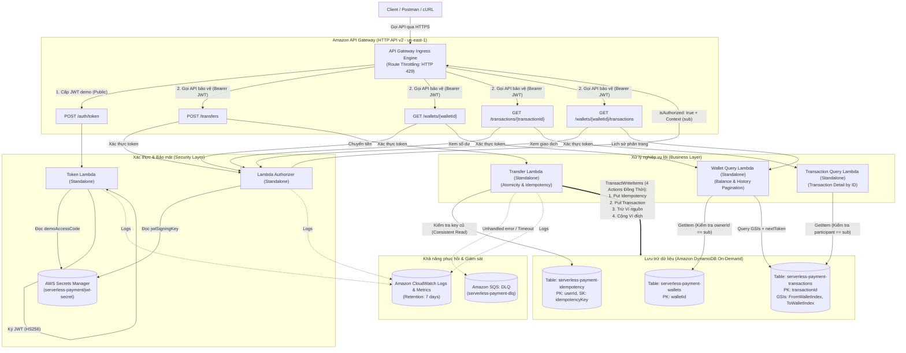

# Serverless Payment Gateway

Hệ thống cổng thanh toán giả lập không máy chủ (Serverless Simulated Payment Gateway) trên nền tảng **Amazon Web Services (AWS)**, bảo đảm tính toàn vẹn dữ liệu tài chính (ACID Transactions), cơ chế chống lặp yêu cầu (Idempotency), và xác thực bảo mật bằng JWT qua Lambda Authorizer.

---

## 📌 Thông tin học phần & Nhóm thực hiện

- **Học phần:** Điện toán đám mây (Cloud Computing) – Đợt 1, Năm học 2026–2027
- **Giảng viên hướng dẫn:** ThS. Huỳnh Xuân Phụng
- **Đề tài:** Cổng thanh toán giả lập với API Gateway, Lambda Authorizer và DynamoDB Transaction
- **Nhóm thực hiện:** Nhóm Serverless
  - **Vũ Minh Đức** – Phân tích nghiệp vụ, Kiến trúc, Thuật toán & Kiểm thử
  - **Nguyễn Nguyên** – Môi trường AWS, IAM, Triển khai hạ tầng, Quản trị tài nguyên & Git
- **GitHub Repository:** [https://github.com/NguyenNguyen0210/serverless-payment](https://github.com/NguyenNguyen0210/serverless-payment)
- **Môi trường triển khai:** AWS Academy Learner Lab (Vocareum)
- **AWS Region thống nhất:** `us-east-1` (US East - N. Virginia)
- **IAM Execution Role:** `arn:aws:iam::<ACCOUNT_ID>:role/LabRole`

---

## 🎯 Mục tiêu và Bài toán kỹ thuật

Dự án mô phỏng hoạt động chuyển tiền trực tuyến giữa các tài khoản ví số dư VND. Trong hệ thống thanh toán, các lỗi mạng, timeout, hoặc thao tác bấm nút nhiều lần từ phía người dùng có thể dẫn tới sự cố trừ tiền hai lần hoặc mất mát trạng thái. Hệ thống được thiết kế nhằm giải quyết triệt để 5 thách thức kỹ thuật cốt lõi:

1. **Tính nguyên tử tài chính (Atomicity & Consistency):**
   - Số tiền chuyển được trừ khỏi ví nguồn và cộng vào ví đích đồng thời.
   - Nếu bất kỳ bước nào thất bại (số dư không đủ, ví bị khóa, lỗi hệ thống), toàn bộ thay đổi sẽ bị hủy bỏ (Rollback).
   - **Giải pháp:** Sử dụng **DynamoDB `TransactWriteItems` 4 hành động đồng thời** trên 3 bảng dữ liệu chuyên biệt (`wallets`, `transactions`, `idempotency`), kết hợp biểu thức điều kiện nghiêm ngặt (`ConditionExpression`).

2. **Chống trùng lặp giao dịch (Idempotency Control):**
   - Đảm bảo rằng việc gửi lại cùng một yêu cầu thanh toán (cùng `Idempotency-Key`) không bao giờ làm thay đổi số dư thêm một lần nữa.
   - **Giải pháp:** Phân tách bảng riêng `serverless-payment-idempotency` với cặp khóa `(userId, idempotencyKey)` kết hợp chuỗi băm chuẩn hóa (`requestHash` - SHA-256). Cơ chế này bảo vệ chống lặp vĩnh viễn trong CSDL, vượt trội so với giới hạn 10 phút của tham số `ClientRequestToken` trên DynamoDB.

3. **Bảo mật và Kiểm soát quyền truy cập (Zero-Trust Security):**
   - Toàn bộ các API nghiệp vụ bắt buộc phải có JSON Web Token (JWT) hợp lệ.
   - Định danh người dùng (`userId`) được trích xuất an toàn từ claim `sub` của JWT qua Lambda Authorizer, ngăn chặn hoàn toàn việc giả mạo định danh qua body hoặc query parameter.
   - **Giải pháp:** **API Gateway HTTP API v2** tích hợp **Lambda Authorizer (REQUEST mode, Simple Responses)** tự kiểm tra chữ ký HS256 và thời hạn với khóa bí mật lưu trữ an toàn trong **AWS Secrets Manager** (không dùng AWS Cognito).

4. **Kiểm soát lưu lượng & Chống tấn công DoS (Rate Limiting & Throttling):**
   - Ngăn chặn tấn công brute-force vào endpoint cấp token và bảo vệ tài nguyên backend khỏi tình trạng cạn kiệt do lưu lượng đột biến.
   - **Giải pháp:** Cấu hình **API Gateway Route & Stage Throttling** (`/auth/token`: Rate 2 RPS, Burst 5; `/transfers`: Rate 10 RPS, Burst 20). Khi lưu lượng vượt ngưỡng, API Gateway tự động phản hồi `429 Too Many Requests` kèm header `Retry-After` tại tầng ingress mà không tiêu tốn tài nguyên Lambda backend.

5. **Xử lý sự cố ngoại lệ & Khôi phục (Resilience & Dead Letter Queue - DLQ):**
   - Đảm bảo không thất thoát các sự kiện lỗi hoặc giao dịch bất thường khi backend gặp sự cố hệ thống nghiêm trọng (unhandled exceptions, timeout).
   - **Giải pháp:** Tích hợp **Amazon SQS Dead Letter Queue (`serverless-payment-dlq`)** gắn với Transfer Lambda để lưu vết toàn bộ payload lỗi phục vụ kiểm tra đối soát thủ công (manual reconciliation) và kích hoạt cảnh báo CloudWatch.

---

## 🏗️ Kiến trúc hệ thống (System Architecture)

Toàn bộ hệ thống được xây dựng trên kiến trúc hướng sự kiện, hoàn toàn không máy chủ (Serverless), hỗ trợ **3 bảng DynamoDB On-Demand**, **5 hàm Lambda độc lập (Standalone)** và **5 API Endpoints**:



---

## 📈 Tiến độ triển khai thực tế theo tuần

### 🗓️ Bảng tổng hợp lộ trình 4 tuần

| Tuần | Mục tiêu trọng tâm | Trạng thái kỹ thuật | Khối lượng giờ công | Minh chứng |
|:---:|---|:---:|:---:|:---:|
| **Tuần 1** | Tìm hiểu dịch vụ, thiết kế kiến trúc, hợp đồng API, schema CSDL, dựng môi trường Lab & Git | **Đạt 100%** | 16,0 giờ (8h/SV) | [09 ảnh minh chứng](evidence/week01/README.md) |
| **Tuần 2** | Triển khai 5 Standalone Lambdas, Secrets Manager, PyJWT Layer, 3 DynamoDB Tables, API Gateway 5 Routes, Scripts CSDL & Tests | **Đạt 100%** | 16,0 giờ (8h/SV) | [38 ảnh minh chứng](evidence/week02/README.md) |
| **Tuần 3** | Tích hợp hoàn chỉnh luồng end-to-end, tối ưu bảo mật, cấu hình CloudWatch Metrics/Alarms & IaC | **Đang thực hiện** | 16,0 giờ (8h/SV) | [22 ảnh minh chứng](evidence/week03/README.md) |
| **Tuần 4** | Kiểm thử chịu tải, Concurrency, đối soát ngân sách $50, dọn dẹp tài nguyên, quay video demo | *Kế hoạch* | 16,0 giờ (8h/SV) | `evidence/week04/` |

---

### 📍 Phân chia công việc Tuần 2 chi tiết:

#### 1. Nguyễn Nguyên (8,00 giờ công):
- **Thiết kế API Gateway HTTP API v2:** Tiếp nhận request HTTPS, định cấu hình 5 routes (`POST /auth/token`, `POST /transfers`, `GET /wallets/{walletId}`, `GET /transactions/{transactionId}`, `GET /wallets/{walletId}/transactions`), tích hợp Lambda Authorizer (REQUEST mode) bảo vệ 4 routes nghiệp vụ.
- **Thiết kế Lambda Authorizer sử dụng PyJWT:** Đóng gói Lambda Layer `pyjwt-layer.zip` (Python 3.12, PyJWT 2.10.1); triển khai hàm `serverless-payment-authorizer` giải mã token, xác thực chữ ký HS256, kiểm tra thời hạn và truyền `context.userId`.
- **Thiết kế lưu trữ khóa JWT bằng Secrets Manager:** Khởi tạo secret `serverless-payment/jwt-secret` lưu trữ an toàn `jwtSigningKey` (≥ 32 bytes) và `demoAccessCode`; triển khai hàm `serverless-payment-token` cấp JWT từ secret.
- **Thiết kế SQS Dead Letter Queue:** Khởi tạo Amazon SQS Standard Queue `serverless-payment-dlq` để lưu vết lỗi unhandled exceptions/timeout.
- **Minh chứng Tuần 2:** **16 ảnh minh chứng** thực tế trên AWS Console/CLI tại [`evidence/week02/nguyen/`](evidence/week02/nguyen/README.md) (`B2-01` đến `B2-16`).

#### 2. Vũ Minh Đức (8,00 giờ công):
- **Thiết kế cấu trúc dữ liệu DynamoDB:** Xây dựng mô hình 3 bảng On-Demand (`serverless-payment-wallets`, `serverless-payment-transactions`, `serverless-payment-idempotency`) và 2 chỉ mục phụ GSIs (`FromWalletIndex`, `ToWalletIndex`). Viết script [`scripts/create_tables.py`](scripts/create_tables.py) và [`scripts/seed_wallets.py`](scripts/seed_wallets.py).
- **Thiết kế chuyển tiền nguyên tử bằng `TransactWriteItems`:** Lập trình hàm `serverless-payment-transfer` thực thi 4 actions nguyên tử: ghi Idempotency record, ghi nhận Transaction, trừ tiền ví nguồn, cộng tiền ví đích.
- **Thiết kế cơ chế chống giao dịch trùng `Idempotency-Key`:** Thuật toán chuẩn hóa payload và băm `requestHash` (SHA-256), cơ chế Idempotent Replay trả về kết quả cũ kèm `replayed: true` mà không trừ tiền hai lần.
- **Thiết kế Route Throttling:** Cấu hình Rate Limiting trên API Gateway (2 RPS cho `/auth/token`, 10 RPS cho `/transfers`) chặn tấn công DoS và brute-force.
- **Xây dựng bộ kiểm thử tự động (56/56 Tests Passed):**
  - [`tests/test_auth.py`](tests/test_auth.py): 16 unit tests kiểm tra trọn vẹn Token & Authorizer (cấp token, kiểm tra demoCode, HMAC-SHA256, kiểm tra thời hạn `exp`, issuer, audience, simple responses).
  - [`tests/test_transfer.py`](tests/test_transfer.py): 23 unit tests kiểm tra nghiệp vụ chuyển tiền, 4 actions nguyên tử trong `TransactWriteItems`, replay chống lặp, xung đột hash báo 409, thiếu tiền báo 409, sai chủ ví báo 403, retry concurrency và SQS DLQ.
  - [`tests/test_query.py`](tests/test_query.py): 17 unit tests kiểm tra tra cứu số dư ví chính chủ (`W001`), chặn ví người khác (403), tra cứu giao dịch bên tham gia/bên thứ ba và phân trang cursor `nextToken`.
- **Minh chứng Tuần 2:** **22 ảnh minh chứng** triển khai và kiểm thử tại [`evidence/week02/duc/`](evidence/week02/duc/README.md) (`A2-01` đến `A2-22`).

---

## 📊 Mô hình dữ liệu DynamoDB (Data Model)

Hệ thống sử dụng **3 bảng Amazon DynamoDB On-Demand Capacity** độc lập tại `us-east-1`:

### 1. Bảng `serverless-payment-wallets`
- **Khóa chính:** Partition Key: `walletId` (String).
- **Thuộc tính:** `ownerId` (String), `balance` (Number VND), `currency` (String, cố định `VND`), `status` (`ACTIVE`/`SUSPENDED`), `createdAt`, `updatedAt`.

### 2. Bảng `serverless-payment-transactions`
- **Khóa chính:** Partition Key: `transactionId` (String - UUID v4).
- **Thuộc tính:** `fromWalletId`, `toWalletId`, `amount`, `currency`, `status: "SUCCESS"`, `timeKey` (`<createdAt>#<transactionId>`), `createdAt`.
- **Global Secondary Indexes (GSIs):**
  - **`FromWalletIndex`:** HASH: `fromWalletId`, RANGE: `timeKey` (truy vấn giao dịch chuyển đi).
  - **`ToWalletIndex`:** HASH: `toWalletId`, RANGE: `timeKey` (truy vấn giao dịch nhận về).

### 3. Bảng `serverless-payment-idempotency`
- **Khóa chính hỗn hợp:** Partition Key: `userId` (String), Sort Key: `idempotencyKey` (String).
- **Thuộc tính:** `requestHash` (String, SHA-256), `transactionId` (String), `createdAt`.

---

## 📡 Đặc tả danh mục API Endpoints

| Phương thức | Đường dẫn | Phân quyền | Header bắt buộc | Throttling | Mô tả chức năng |
|---|---|---|---|---|---|
| `POST` | `/auth/token` | Public | `Content-Type: application/json` | Rate: 2 RPS, Burst: 5 | Xác thực demoCode & cấp phát Bearer JWT (hạn 15 phút). Chống brute-force. |
| `POST` | `/transfers` | Protected (Authorizer) | `Authorization: Bearer <token>`<br>`Idempotency-Key: <UUID>` | Rate: 10 RPS, Burst: 20 | Chuyển tiền nguyên tử qua 4-action TransactWriteItems. Idempotent Replay. |
| `GET` | `/wallets/{walletId}` | Protected (Authorizer) | `Authorization: Bearer <token>` | Rate: 10 RPS, Burst: 20 | Tra cứu số dư ví chính chủ (`ownerId == sub`). 403 nếu người khác gọi. |
| `GET` | `/transactions/{transactionId}` | Protected (Authorizer) | `Authorization: Bearer <token>` | Rate: 10 RPS, Burst: 20 | Tra cứu chi tiết một giao dịch. 403 nếu người gọi không tham gia giao dịch. |
| `GET` | `/wallets/{walletId}/transactions` | Protected (Authorizer) | `Authorization: Bearer <token>` | Rate: 10 RPS, Burst: 20 | Lịch sử giao dịch ví có phân trang (`limit` 1..50, con trỏ `nextToken`). |

---

## 📁 Cấu trúc thư mục dự án

```text
serverless-payment/
├── design/                         # Bản thiết kế kiến trúc và đặc tả kỹ thuật chuẩn hóa
│   ├── architecture.md             # Kiến trúc hệ thống, Auth flow, 4-action ACID, Rate Limit, DLQ & ADRs (ADR-01 -> ADR-14)
│   └── openapi.yaml                # Đặc tả máy đọc được OpenAPI 3.0 cho cả 5 endpoints với đầy đủ mã lỗi HTTP
├── docs/                           # Hồ sơ phân tích nghiệp vụ, mô hình dữ liệu và kiểm thử
│   ├── business-rules.md           # 17 quy tắc nghiệp vụ chuyển tiền, phân quyền ví và bảo toàn số dư (BR-01 -> BR-17)
│   ├── data-model.md               # Thiết kế CSDL 3 bảng DynamoDB, dual GSIs và giao dịch TransactWriteItems
│   ├── api-contract.md             # Hợp đồng API chi tiết cho 5 routes kèm cú pháp cURL kiểm thử
│   ├── test-scenarios.md           # Kế hoạch & Ma trận 26 kịch bản kiểm thử (TC-01 -> TC-26)
│   ├── repository.md               # Thông tin kho lưu trữ GitHub và chỉ mục tài liệu
│   └── worklog.md                  # Nhật ký công việc nhóm chi tiết theo tuần
├── evidence/                       # Ảnh chụp minh chứng thao tác thực tế trên AWS
│   ├── week01/                     # Minh chứng tuần 1: Learner Lab, STS, CLI, Budget (B1-01 -> B2-03)
│   │   └── README.md
│   └── week02/                     # Minh chứng tuần 2: Triển khai thực tế trên AWS
│       ├── README.md               # Danh mục tổng hợp minh chứng Tuần 2
│       ├── nguyen/                 # 16 ảnh minh chứng của Nguyễn Nguyên (B2-01 -> B2-16)
│       │   └── README.md
│       └── duc/                    # 22 ảnh minh chứng của Vũ Minh Đức (A2-01 -> A2-22)
│           └── README.md
├── scripts/                        # Kịch bản tự động hóa khởi tạo dữ liệu DynamoDB
│   ├── create_tables.py            # Khởi tạo an toàn 3 bảng DynamoDB và 2 GSIs (Idempotent)
│   └── seed_wallets.py             # Nạp dữ liệu 4 ví mẫu (W001 -> W004) không ghi đè số dư
├── src/                            # Mã nguồn 5 Lambda Functions độc lập (Standalone - Không cần shared.py)
│   ├── token/                      # POST /auth/token: Xác thực demoCode & cấp phát JWT HS256
│   │   └── lambda_function.py
│   ├── authorizer/                 # Lambda Authorizer: REQUEST mode, giải mã JWT & kiểm tra quyền
│   │   └── lambda_function.py
│   ├── transfer/                   # POST /transfers: DynamoDB TransactWriteItems 4 actions & Idempotency
│   │   └── lambda_function.py
│   ├── wallet_query/               # GET /wallets/{id} & /wallets/{id}/transactions: Số dư & lịch sử phân trang
│   │   └── lambda_function.py
│   └── transaction_query/          # GET /transactions/{id}: Chi tiết giao dịch theo ID
│       └── lambda_function.py
├── tests/                          # Bộ 56 mã kiểm thử tự động (Unit Tests) & Mock Payloads
│   ├── test_auth.py                # 16 Unit tests cho Token và Authorizer (PyJWT)
│   ├── test_transfer.py            # 23 Unit tests cho Transfer Lambda & 4-action Transaction
│   ├── test_query.py               # 17 Unit tests cho Wallet Query & Transaction Query
│   └── events/                     # Mẫu HTTP API v2 JSON events phục vụ kiểm thử
│       ├── transfer_success.json
│       ├── transfer_insufficient.json
│       └── transfer_wrong_owner.json
├── requirements-layer.txt          # Khai báo dependency cho Lambda Layer (PyJWT==2.10.1)
├── requirements-test.txt           # Khai báo dependency phục vụ unit testing
├── .gitignore                      # Cấu hình loại trừ build artifacts (*.zip, dist/), cache và keys
└── README.md                       # Tài liệu tổng quan dự án (tệp hiện tại)
```

---

## 📚 Danh mục tài liệu tham chiếu

Tài liệu được tinh gọn, hợp nhất để tránh phân mảnh:

- 📋 **Quản lý & Nhật ký:**
  - [Nhật ký công việc nhóm chi tiết](docs/worklog.md)
  - [Thông tin kho lưu trữ GitHub & Chỉ mục tài liệu](docs/repository.md)
- 📐 **Kiến trúc & Đặc tả API:**
  - [Kiến trúc hệ thống, Xác thực JWT, 4-action ACID, Rate Limit, DLQ & ADRs (ADR-01 -> ADR-14)](design/architecture.md)
  - [Đặc tả máy đọc được OpenAPI 3.0 (5 Endpoints)](design/openapi.yaml)
  - [Hợp đồng API chi tiết cho 5 routes kèm cURL kiểm thử](docs/api-contract.md)
- 💼 **Nghiệp vụ, CSDL & Kiểm thử:**
  - [17 Quy tắc nghiệp vụ chuyển tiền & Bất biến số dư](docs/business-rules.md)
  - [Mô hình dữ liệu 3 bảng DynamoDB & Dual GSIs](docs/data-model.md)
  - [Kế hoạch & Ma trận 26 kịch bản kiểm thử (Test Scenarios)](docs/test-scenarios.md)

---

## 🚀 Hướng dẫn khởi tạo CSDL & Kiểm thử API

### 1. Khởi tạo 3 bảng DynamoDB & 2 GSIs

```bash
# Xem trước các thao tác sẽ tạo (Dry-run)
python scripts/create_tables.py

# Thực thi tạo bảng và chỉ mục trên AWS
python scripts/create_tables.py --apply
```

### 2. Nạp dữ liệu 4 ví khởi tạo (W001 -> W004)

```bash
# Nạp an toàn không ghi đè số dư ví đã có
python scripts/seed_wallets.py --apply
```

### 3. Kiểm thử API bằng cURL

Hệ thống hỗ trợ kiểm thử trực tiếp cả 5 endpoints bằng lệnh cURL trên terminal hoặc Postman (xem chi tiết cú pháp tại [`docs/api-contract.md`](docs/api-contract.md)).

### 4. Chạy toàn bộ bộ Unit Tests tự động (56/56 Tests Passed)

```bash
python -m unittest discover -s tests -v
```
