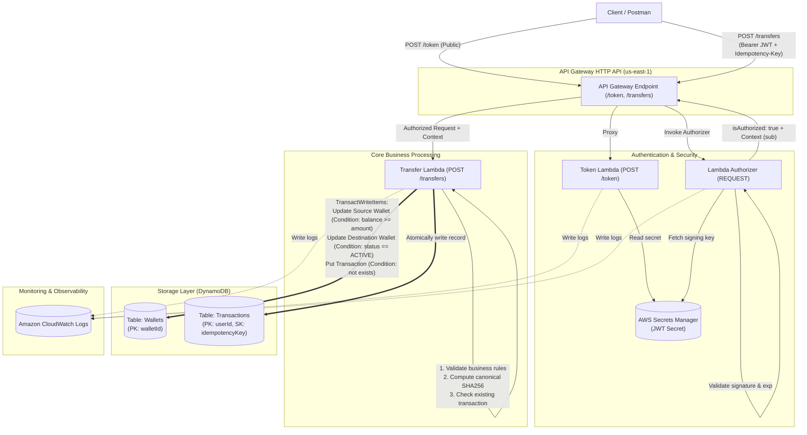

# Serverless Payment Gateway

Hệ thống cổng thanh toán giả lập không máy chủ (Serverless Simulated Payment Gateway) trên nền tảng **Amazon Web Services (AWS)**, bảo đảm tính toàn vẹn dữ liệu tài chính (ACID Transactions), cơ chế chống lặp yêu cầu (Idempotency), và xác thực bảo mật bằng JWT qua Lambda Authorizer.

---

## 📌 Thông tin học phần & Nhóm thực hiện

- **Học phần:** Điện toán đám mây (Cloud Computing) – Đợt 1, Năm học 2026–2027
- **Giảng viên hướng dẫn:** ThS. Huỳnh Xuân Phụng
- **Đề tài:** Cổng thanh toán giả lập với API Gateway, Lambda Authorizer và DynamoDB Transaction
- **Nhóm thực hiện:** Nhóm Serverless
  - **Vũ Minh Đức** – Phân tích nghiệp vụ, Kiến trúc & Thiết kế kỹ thuật
  - **Nguyễn Nguyên** – Môi trường AWS, IAM, Quản trị tài nguyên & Git
- **Môi trường triển khai:** AWS Academy Learner Lab (Vocareum)
- **AWS Region thống nhất:** `us-east-1` (US East - N. Virginia)
- **IAM Execution Role:** `arn:aws:iam::<ACCOUNT_ID>:role/LabRole`

---

## 🎯 Mục tiêu và Bài toán kỹ thuật

Dự án mô phỏng hoạt động chuyển tiền trực tuyến giữa các tài khoản ví số dư VND. Trong hệ thống thanh toán, các lỗi mạng, timeout, hoặc thao tác bấm nút nhiều lần từ phía người dùng có thể dẫn tới sự cố trừ tiền hai lần hoặc mất mát trạng thái. Hệ thống được thiết kế nhằm giải quyết triệt để 3 thách thức kỹ thuật cốt lõi:

1. **Tính nguyên tử tài chính (Atomicity & Consistency):**
   - Số tiền chuyển được trừ khỏi ví nguồn và cộng vào ví đích đồng thời.
   - Nếu bất kỳ bước nào thất bại (số dư không đủ, ví bị khóa, lỗi hệ thống), toàn bộ thay đổi sẽ bị hủy bỏ (Rollback).
   - Giải pháp: Sử dụng **DynamoDB `TransactWriteItems`** kết hợp các biểu thức điều kiện (`ConditionExpression`) trên cả hai bản ghi ví và bản ghi giao dịch.

2. **Chống trùng lặp giao dịch (Idempotency Control):**
   - Đảm bảo rằng việc gửi lại cùng một yêu cầu thanh toán (cùng `Idempotency-Key`) không bao giờ làm thay đổi số dư thêm một lần nữa.
   - Giải pháp: Kết hợp cặp khóa `(userId, idempotencyKey)` làm Primary Key cho bảng `Transactions` và lưu chuỗi băm yêu cầu chuẩn hóa (`requestHash` - SHA-256). Cơ chế này bảo vệ vĩnh viễn trong cơ sở dữ liệu, vượt trội so với giới hạn 10 phút của tham số `ClientRequestToken` trên DynamoDB.

3. **Bảo mật và Kiểm soát quyền truy cập (Zero-Trust Security):**
   - Toàn bộ các API giao dịch bắt buộc phải có JSON Web Token (JWT) hợp lệ.
   - Định danh người dùng (`userId`) được trích xuất an toàn từ claim `sub` của JWT, ngăn chặn việc giả mạo `userId` qua body payload.
   - Giải pháp: **API Gateway HTTP API** tích hợp **Lambda Authorizer (REQUEST)**, tự kiểm tra chữ ký HS256 và thời hạn với khóa bí mật lưu trữ an toàn trong **AWS Secrets Manager**.

---

## 🏗️ Kiến trúc hệ thống (Architecture)

Toàn bộ hệ thống được xây dựng trên kiến trúc hướng sự kiện, hoàn toàn không máy chủ (Serverless), tận dụng các dịch vụ pin-point của AWS để tối ưu độ trễ và chi phí hoạt động:



---

## 📊 Mô hình dữ liệu DynamoDB (Data Model)

Hệ thống sử dụng hai bảng DynamoDB với chế độ thanh toán theo yêu cầu (On-Demand Capacity):

### 1. Bảng `Wallets`
Quản lý thông tin tài khoản và số dư ví:
- **Partition Key (PK):** `walletId` (String, ví dụ: `W001`, `W002`)
- **Các thuộc tính:**
  - `ownerId` (String): ID người dùng sở hữu ví (khớp với claim `sub` trong JWT).
  - `balance` (Number): Số dư khả dụng tính bằng VND (luôn là số nguyên dương, không âm).
  - `currency` (String): Loại tiền tệ (cố định `VND`).
  - `status` (String): Trạng thái ví (`ACTIVE` hoặc `SUSPENDED`).
  - `createdAt` / `updatedAt` (String): Thời gian chuẩn UTC ISO 8601.

### 2. Bảng `Transactions`
Lưu trữ lịch sử giao dịch và phục vụ cơ chế chống lặp:
- **Partition Key (PK):** `userId` (String, lấy từ token)
- **Sort Key (SK):** `idempotencyKey` (String, lấy từ header `Idempotency-Key`)
- **Các thuộc tính:**
  - `transactionId` (String): Mã định danh duy nhất của giao dịch (UUID v4 do server sinh).
  - `requestHash` (String): Mã băm SHA-256 từ nội dung yêu cầu đã chuẩn hóa (canonical payload).
  - `fromWalletId` (String): Ví chuyển tiền.
  - `toWalletId` (String): Ví nhận tiền.
  - `amount` (Number): Số tiền chuyển (VND).
  - `currency` (String): Loại tiền tệ (`VND`).
  - `status` (String): Trạng thái giao dịch (`SUCCESS`).
  - `createdAt` (String): Thời gian hoàn thành giao dịch (UTC ISO 8601).

---

## 📡 Đặc tả API Endpoints

| Phương thức | Đường dẫn | Phân quyền | Header bắt buộc | Mô tả |
|---|---|---|---|---|
| `POST` | `/token` | Public (Kiểm tra mã demo) | `Content-Type: application/json` | Cấp JWT truy cập demo có thời hạn (15 phút). |
| `POST` | `/transfers` | Protected (Lambda Authorizer) | `Authorization: Bearer <token>`<br>`Idempotency-Key: <uuid>`<br>`Content-Type: application/json` | Thực hiện chuyển tiền an toàn giữa 2 ví. |
| `GET` | `/transactions/{id}` | Protected (Mở rộng) | `Authorization: Bearer <token>` | Tra cứu thông tin giao dịch theo ID. |

---

## 📁 Cấu trúc thư mục dự án

```text
serverless-payment/
├── design/                         # Bản thiết kế kiến trúc và đặc tả kỹ thuật
│   ├── architecture.md             # Sơ đồ kiến trúc Mermaid, tương tác & ADRs (ADR-01 -> ADR-10)
│   └── openapi.yaml                # Đặc tả giao diện máy đọc được OpenAPI 3.0
├── docs/                           # Hồ sơ phân tích nghiệp vụ, an toàn và vận hành
│   ├── project-requirements.md     # Đề bài & yêu cầu kỹ thuật đồ án (GVHD: Huỳnh Xuân Phụng)
│   ├── business-rules.md           # 14 quy tắc nghiệp vụ chuyển tiền & bất biến số dư (BR-01 -> BR-14)
│   ├── api-contract.md             # Đặc tả hợp đồng API (Request, Response, Error codes)
│   ├── data-model.md               # Thiết kế CSDL DynamoDB & giao dịch ACID (TransactWriteItems)
│   ├── auth-flow.md                # Kiến trúc xác thực JWT (PyJWT) & Lambda Authorizer
│   ├── test-scenarios.md           # Kế hoạch & Ma trận 19 kịch bản kiểm thử (TC-01 -> TC-19)
│   ├── aws-environment.md          # Báo cáo khảo sát môi trường AWS Learner Lab & CLI
│   ├── resource-management.md      # Chính sách quản trị tài nguyên & kiểm soát ngân sách $50
│   └── worklog.md                  # Nhật ký công việc nhóm chi tiết Tuần 1
├── evidence/                       # Ảnh chụp minh chứng thao tác trên AWS
│   └── week01/                     # Minh chứng tuần 1: Learner Lab, STS, CLI, Budget (B1-01 -> B2-03)
│       └── README.md               # Danh mục chỉ mục minh chứng Tuần 1
├── examples/                       # Các ví dụ mẫu và kịch bản chạy thử
│   └── api-examples.md             # Hướng dẫn kiểm thử API bằng lệnh cURL
├── infra/                          # Kịch bản triển khai hạ tầng AWS (IaC / Scripts)
├── src/                            # Mã nguồn các Lambda Functions (token, authorizer, payment)
├── tests/                          # Bộ mã kiểm thử tự động (Unit & Integration Tests)
├── .gitignore                      # Cấu hình bảo vệ thông tin bí mật và tệp tạm thời
└── README.md                       # Tài liệu tổng quan dự án
```

---

## 📚 Danh mục tài liệu tham chiếu chi tiết

Để tìm hiểu chi tiết từng khía cạnh kỹ thuật, vui lòng tham khảo các tài liệu tương ứng:

- 📋 **Yêu cầu & Quy định môn học:**
  - [Đề bài & Yêu cầu kỹ thuật đồ án (GVHD: Huỳnh Xuân Phụng)](docs/project-requirements.md)
  - [Nhật ký công việc & Báo cáo giờ công Tuần 1](docs/worklog.md)
- 📐 **Kiến trúc & Đặc tả:**
  - [Kiến trúc hệ thống & Quyết định thiết kế ADR (ADR-01 -> ADR-10)](design/architecture.md)
  - [Đặc tả máy đọc được OpenAPI 3.0](design/openapi.yaml)
- 💼 **Phân tích nghiệp vụ & Cơ sở dữ liệu:**
  - [14 Quy tắc nghiệp vụ chuyển tiền & Bất biến số dư](docs/business-rules.md)
  - [Hợp đồng API & Mã lỗi HTTP chuẩn hóa](docs/api-contract.md)
  - [Mô hình dữ liệu DynamoDB & Giao dịch TransactWriteItems](docs/data-model.md)
  - [Kiến trúc xác thực JWT & Lambda Authorizer](docs/auth-flow.md)
- 🧪 **Kiểm thử & Minh chứng:**
  - [Kế hoạch & Ma trận 19 kịch bản kiểm thử (Test Scenarios)](docs/test-scenarios.md)
  - [Hướng dẫn kiểm thử API bằng lệnh cURL](examples/api-examples.md)
  - [Danh mục bằng chứng xác minh môi trường Tuần 1](evidence/week01/README.md)
- ⚙️ **Hạ tầng, Chi phí & Vận hành:**
  - [Báo cáo xác minh môi trường AWS Learner Lab](docs/aws-environment.md)
  - [Chính sách quản trị tài nguyên & Kiểm soát ngân sách](docs/resource-management.md)

---

## 👥 Phân công trách nhiệm & Kế hoạch triển khai

### Phân công thành viên

| Thành viên | Trách nhiệm chính trong đồ án |
|---|---|
| **Vũ Minh Đức** | Phân tích nghiệp vụ chuyển tiền; Đặc tả hợp đồng API & OpenAPI 3.0; Thiết kế CSDL DynamoDB & giao dịch ACID TransactWriteItems; Thiết kế cơ chế xác thực JWT qua Lambda Authorizer và xây dựng bộ 19 kịch bản kiểm thử. |
| **Nguyễn Nguyên** | Khảo sát nền tảng AWS Academy Learner Lab; Cấu hình AWS CLI & xác minh quyền IAM `LabRole`; Khởi tạo và chuẩn hóa cấu trúc Git repository; Xây dựng chính sách quản trị tài nguyên, kiểm soát ngân sách $50 và thu thập hồ sơ minh chứng. |

### Lộ trình thực hiện 4 tuần (Mỗi thành viên ≥ 8 giờ/tuần)

- **Tuần 1: Tìm hiểu dịch vụ, thiết kế kiến trúc & Dựng nền tảng (Đã hoàn thành)**
  - Tìm hiểu các dịch vụ AWS liên quan (API Gateway, Lambda, DynamoDB, Secrets Manager, CloudWatch).
  - Phân tích nghiệp vụ, thiết kế kiến trúc, vẽ sơ đồ và đặc tả API.
  - Khảo sát môi trường AWS Learner Lab (`us-east-1`, IAM `LabRole`, AWS CLI).
  - Khởi tạo Git repository, cấu trúc thư mục, quy định gắn thẻ tài nguyên (`Project/Owner`) và ngân sách.
- **Tuần 2: Triển khai chức năng lõi trên AWS & Kiểm thử thành phần**
  - Khởi tạo bảng DynamoDB `Wallets` và `Transactions`.
  - Thiết lập khóa bí mật JWT trên AWS Secrets Manager.
  - Lập trình và triển khai các Lambda Functions: `Token Lambda`, `Transfer Lambda`.
  - Kiểm thử độc lập từng thành phần lõi.
- **Tuần 3: Tích hợp, Bảo mật, Giám sát & Tự động hóa**
  - Cấu hình API Gateway HTTP API, tích hợp Lambda Authorizer (REQUEST mode, PyJWT).
  - Tích hợp luồng chuyển tiền hoàn chỉnh và kiểm soát phân quyền (`sub` = chủ ví).
  - Thiết lập giám sát với CloudWatch Logs, Metrics & Alarms.
  - Xây dựng kịch bản tự động hóa / IaC (nếu có).
- **Tuần 4: Kiểm thử tổng thể, Tối ưu chi phí, Viết báo cáo & Demo**
  - Thực thi kiểm thử toàn diện (16+ test cases, concurrency, idempotent replay).
  - Đo đạc chi phí thực tế, tối ưu hóa ngân sách và dọn dẹp tài nguyên trên Learner Lab.
  - Hoàn thiện báo cáo tổng kết đồ án.
  - Quay video demo hệ thống (thời lượng ≤ 10 phút).

---

## 🔐 Nguyên tắc bảo mật & Quản lý chi phí

1. **Bảo vệ thông tin định danh & Bí mật:**
   - Tuyệt đối không lưu trữ AWS Access Key, Secret Key, Session Token hay JWT Secret trong mã nguồn hoặc commit lên Git repository.
   - Các biến cấu hình nhạy cảm được quản lý thông qua biến môi trường Lambda hoặc AWS Secrets Manager.
2. **Kiểm soát ngân sách $50 của Learner Lab:**
   - Toàn bộ tài nguyên nhóm tạo ra đều bắt buộc gắn thẻ (Tag):
     - `Project`: `serverless-payment`
     - `Owner`: `Serverless-Team`
   - Thiết lập thời gian lưu trữ log CloudWatch (Log Retention) hợp lý để tránh phát sinh chi phí lưu trữ không cần thiết.
   - Không sử dụng các tài nguyên trả phí theo giờ cao như VPC NAT Gateway, RDS hay EC2 Instances.

---

## 🚀 Hướng dẫn bắt đầu (Quick Start)

### 1. Cấu hình terminal với AWS CLI

Thiết lập thông tin phiên đăng nhập từ AWS Academy Learner Lab vào terminal của bạn:

```bash
export AWS_REGION=us-east-1
export AWS_DEFAULT_REGION=us-east-1
export AWS_PAGER=""

# Kiểm tra danh tính đang sử dụng
aws sts get-caller-identity
```

### 2. Kiểm tra quyền và các dịch vụ cơ bản

```bash
# Kiểm tra danh sách bảng DynamoDB
aws dynamodb list-tables --region us-east-1

# Kiểm tra thông tin LabRole
aws iam get-role --role-name LabRole
```
