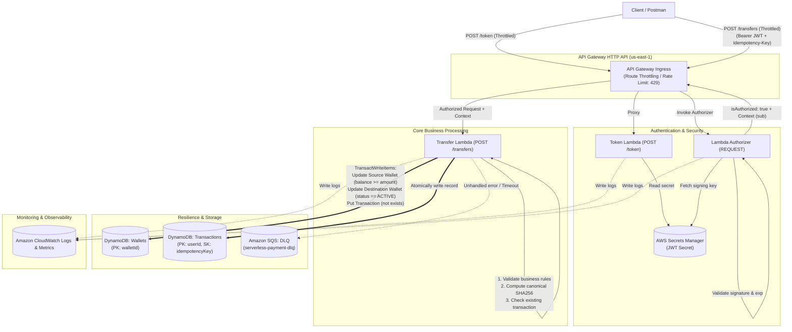

# Serverless Payment Gateway

Hệ thống cổng thanh toán giả lập không máy chủ (Serverless Simulated Payment Gateway) trên nền tảng **Amazon Web Services (AWS)**, bảo đảm tính toàn vẹn dữ liệu tài chính (ACID Transactions), cơ chế chống lặp yêu cầu (Idempotency), và xác thực bảo mật bằng JWT qua Lambda Authorizer.

---

## 📌 Thông tin học phần & Nhóm thực hiện

- **Học phần:** Điện toán đám mây (Cloud Computing) – Đợt 1, Năm học 2026–2027
- **Giảng viên hướng dẫn:** ThS. Huỳnh Xuân Phụng
- **Đề tài:** Cổng thanh toán giả lập với API Gateway, Lambda Authorizer và DynamoDB Transaction
- **Nhóm thực hiện:** Nhóm Serverless
  - **Vũ Minh Đức** – Phân tích nghiệp vụ, Kiến trúc, Thuật toán & Kiểm thử
  - **Nguyễn Nguyên** – Môi trường AWS, IAM, Triển khai hạ tầng, Quản trị tài nguyên & Git
- **GitHub Repository:** [https://github.com/NguyenNguyen0210/serverless-payment](https://github.com/NguyenNguyen0210/serverless-payment)
- **Môi trường triển khai:** AWS Academy Learner Lab (Vocareum)
- **AWS Region thống nhất:** `us-east-1` (US East - N. Virginia)
- **IAM Execution Role:** `arn:aws:iam::<ACCOUNT_ID>:role/LabRole`

---

## 🎯 Mục tiêu và Bài toán kỹ thuật

Dự án mô phỏng hoạt động chuyển tiền trực tuyến giữa các tài khoản ví số dư VND. Trong hệ thống thanh toán, các lỗi mạng, timeout, hoặc thao tác bấm nút nhiều lần từ phía người dùng có thể dẫn tới sự cố trừ tiền hai lần hoặc mất mát trạng thái. Hệ thống được thiết kế nhằm giải quyết triệt để 5 thách thức kỹ thuật cốt lõi:

1. **Tính nguyên tử tài chính (Atomicity & Consistency):**
   - Số tiền chuyển được trừ khỏi ví nguồn và cộng vào ví đích đồng thời.
   - Nếu bất kỳ bước nào thất bại (số dư không đủ, ví bị khóa, lỗi hệ thống), toàn bộ thay đổi sẽ bị hủy bỏ (Rollback).
   - Giải pháp: Sử dụng **DynamoDB `TransactWriteItems`** kết hợp các biểu thức điều kiện (`ConditionExpression`) trên cả hai bản ghi ví và bản ghi giao dịch.

2. **Chống trùng lặp giao dịch (Idempotency Control):**
   - Đảm bảo rằng việc gửi lại cùng một yêu cầu thanh toán (cùng `Idempotency-Key`) không bao giờ làm thay đổi số dư thêm một lần nữa.
   - Giải pháp: Kết hợp cặp khóa `(userId, idempotencyKey)` làm Primary Key cho bảng `Transactions` và lưu chuỗi băm yêu cầu chuẩn hóa (`requestHash` - SHA-256). Cơ chế này bảo vệ vĩnh viễn trong cơ sở dữ liệu, vượt trội so với giới hạn 10 phút của tham số `ClientRequestToken` trên DynamoDB.

3. **Bảo mật và Kiểm soát quyền truy cập (Zero-Trust Security):**
   - Toàn bộ các API giao dịch bắt buộc phải có JSON Web Token (JWT) hợp lệ.
   - Định danh người dùng (`userId`) được trích xuất an toàn từ claim `sub` của JWT, ngăn chặn việc giả mạo `userId` qua body payload.
   - Giải pháp: **API Gateway HTTP API** tích hợp **Lambda Authorizer (REQUEST)**, tự kiểm tra chữ ký HS256 và thời hạn với khóa bí mật lưu trữ an toàn trong **AWS Secrets Manager**.

4. **Kiểm soát lưu lượng & Chống tấn công DoS (Rate Limiting & Throttling):**
   - Ngăn chặn tấn công brute-force vào endpoint cấp token và bảo vệ tài nguyên backend khỏi tình trạng cạn kiệt do lưu lượng đột biến.
   - Giải pháp: Cấu hình **API Gateway Route & Stage Throttling** (`/token`: Rate 2 RPS, Burst 5; `/transfers`: Rate 10 RPS, Burst 20). Khi lưu lượng vượt ngưỡng, API Gateway tự động phản hồi `429 Too Many Requests` kèm header `Retry-After` tại tầng ingress mà không tiêu tốn tài nguyên Lambda backend.

5. **Xử lý sự cố ngoại lệ & Khôi phục (Resilience & Dead Letter Queue - DLQ):**
   - Đảm bảo không thất thoát các sự kiện lỗi hoặc giao dịch bất thường khi backend gặp sự cố hệ thống nghiêm trọng (unhandled exceptions, timeout hoặc DynamoDB degradation).
   - Giải pháp: Tích hợp **Amazon SQS Dead Letter Queue (`serverless-payment-dlq`)** gắn với Lambda Function để lưu vết toàn bộ payload lỗi phục vụ kiểm tra đối soát thủ công (manual reconciliation) và kích hoạt cảnh báo CloudWatch.

---

## 🏗️ Kiến trúc hệ thống (Architecture)

Toàn bộ hệ thống được xây dựng trên kiến trúc hướng sự kiện, hoàn toàn không máy chủ (Serverless), tích hợp đầy đủ kiểm soát lưu lượng và hàng đợi xử lý sự cố:



---

## 📈 Tiến độ triển khai thực tế theo tuần (Weekly Progress & Work Breakdown)

### 🗓️ Bảng tổng hợp lộ trình 4 tuần

| Tuần | Mục tiêu trọng tâm | Trạng thái kỹ thuật | Khối lượng giờ công | Minh chứng |
|:---:|---|:---:|:---:|:---:|
| **Tuần 1** | Tìm hiểu dịch vụ, thiết kế kiến trúc, hợp đồng API, schema CSDL, dựng môi trường Lab & Git | **Đạt 100%** | 16,0 giờ (8h/SV) | [09 ảnh minh chứng](evidence/week01/README.md) |
| **Tuần 2** | Triển khai Lambda functions, Secrets Manager, PyJWT Layer, DynamoDB Table, API Gateway & Tests | **Đạt 100%** | 16,0 giờ (8h/SV) | [16 ảnh minh chứng](evidence/week02/README.md) |
| **Tuần 3** | Tích hợp hoàn chỉnh luồng end-to-end, tối ưu bảo mật, cấu hình CloudWatch Metrics/Alarms & IaC | *Kế hoạch* | 16,0 giờ (8h/SV) | `evidence/week03/` |
| **Tuần 4** | Kiểm thử chịu tải, Concurrency, đối soát ngân sách $50, dọn dẹp tài nguyên, quay video demo | *Kế hoạch* | 16,0 giờ (8h/SV) | `evidence/week04/` |

---

### 📍 TUẦN 1: THIẾT KẾ KIẾN TRÚC & NỀN TẢNG HẠ TẦNG (ĐÃ HOÀN THÀNH)

Trong Tuần 1 (05/10/2026 – 11/10/2026), nhóm đã hoàn thiện toàn bộ hồ sơ thiết kế kỹ thuật, phân tích nghiệp vụ và xác minh môi trường lab:

#### 1. Nguyễn Nguyên (8,00 giờ công – Mã công việc B1 -> B4):
- **Khảo sát môi trường AWS Learner Lab:** Xác thực phiên làm việc STS, kiểm tra Account ID `930162821234`, Region `us-east-1`, phiên bản AWS CLI `2.37.6` và mức tiêu thụ ngân sách ban đầu `$0/$50`.
- **Rà soát phân quyền IAM:** Kiểm tra quyền `LabRole` có sẵn, khảo sát các dịch vụ cốt lõi (API Gateway, Lambda, DynamoDB, Secrets Manager, CloudWatch).
- **Khởi tạo & Quản trị Git:** Tạo Git repo công khai, chuẩn hóa cây thư mục, cấu hình file `.gitignore` bảo vệ khóa bí mật và thiết lập tài liệu `README.md`.
- **Chính sách tài nguyên & DLQ:** Xây dựng quy tắc gắn thẻ (`Project=serverless-payment`), kế hoạch kiểm soát ngân sách $50 và kiến trúc hàng đợi sự cố Amazon SQS DLQ.
- **Minh chứng Tuần 1:** Hoàn thành báo cáo [`docs/aws-environment.md`](docs/aws-environment.md), [`docs/resource-management.md`](docs/resource-management.md) và bộ 09 ảnh chụp [`evidence/week01/`](evidence/week01/README.md) (`B1-01` đến `B2-03`).

#### 2. Vũ Minh Đức (8,00 giờ công – Mã công việc A1 -> A4):
- **Phân tích nghiệp vụ thanh toán:** Thiết lập 14 quy tắc nghiệp vụ tài chính (BR-01 đến BR-14) và nguyên tắc bảo toàn số dư (zero double-spending).
- **Hợp đồng API & OpenAPI 3.0:** Thiết kế hợp đồng API chuẩn cho `POST /token` và `POST /transfers`, định nghĩa mã lỗi HTTP, cơ chế Rate Limiting (429 Throttling) và viết đặc tả máy đọc [`design/openapi.yaml`](design/openapi.yaml).
- **Thiết kế CSDL & DynamoDB Transaction:** Thiết kế mô hình dữ liệu bảng `Wallets` và `Transactions`, cấu trúc lệnh nguyên tử `TransactWriteItems` và thuật toán băm chuẩn hóa `requestHash`.
- **Thiết kế xác thực & Kế hoạch kiểm thử:** Thiết kế luồng xác thực JWT qua Lambda Authorizer (HS256, PyJWT), 12 quyết định kiến trúc ADR và ma trận 21 kịch bản kiểm thử (TC-01 đến TC-21).
- **Hồ sơ Tuần 1:** Hoàn thành 04 tài liệu chuyên sâu: [`docs/business-rules.md`](docs/business-rules.md), [`docs/api-contract.md`](docs/api-contract.md), [`docs/data-model.md`](docs/data-model.md), [`docs/auth-flow.md`](docs/auth-flow.md) và [`docs/test-scenarios.md`](docs/test-scenarios.md).

---

### 📍 TUẦN 2: TRIỂN KHAI CHỨC NĂNG LÕI TRÊN AWS & KIỂM THỬ (ĐÃ HOÀN THÀNH)

Trong Tuần 2 (12/10/2026 – 18/10/2026), nhóm đã hiện thực hóa toàn bộ thiết kế thành mã nguồn và triển khai kiểm thử thực tế trên AWS:

#### 1. Nguyễn Nguyên (8,00 giờ công – API Gateway, Lambda Authorizer, Secrets Manager & SQS DLQ):
- **Thiết kế lưu trữ khóa JWT bằng Secrets Manager:** Khởi tạo secret `serverless-payment/jwt-secret` lưu trữ an toàn `jwtSigningKey` (≥ 32 bytes) và `demoAccessCode`; cấu hình hàm `TokenLambda` ([`src/token/lambda_function.py`](src/token/lambda_function.py)) cấp token JWT HS256 từ secret.
- **Thiết kế Lambda Authorizer sử dụng PyJWT:** Đóng gói Lambda Layer `pyjwt-layer.zip` (Python 3.12, PyJWT 2.10.1); triển khai hàm `AuthorizerLambda` ([`src/authorizer/lambda_function.py`](src/authorizer/lambda_function.py)) xác thực Bearer JWT và truyền `context.userId`.
- **Thiết kế API Gateway HTTP API v2:** Tiếp nhận request HTTPS, tạo 2 routes `POST /token` và `POST /transfers`, tích hợp Lambda Authorizer (REQUEST mode) bảo vệ route chuyển tiền.
- **Thiết kế SQS Dead Letter Queue:** Khởi tạo Amazon SQS Standard Queue `serverless-payment-dlq` để lưu vết lỗi unhandled exceptions/timeout.
- **Hồ sơ minh chứng Tuần 2:** Chụp và phân loại đầy đủ **16 ảnh minh chứng** thực tế trên AWS Console/CLI lưu tại [`evidence/week02/nguyen/`](evidence/week02/nguyen/README.md) (`B2-01` đến `B2-16`).

#### 2. Vũ Minh Đức (8,00 giờ công – Cấu trúc CSDL DynamoDB, TransactWriteItems, Idempotency & Route Throttling):
- **Thiết kế cấu trúc dữ liệu DynamoDB:** Xây dựng mô hình Single-Table trên bảng `serverless-payment` (PK/SK, Partitioning logic); viết script [`scripts/seed_wallets.py`](scripts/seed_wallets.py) nạp dữ liệu 4 ví mẫu (`W001` đến `W004`).
- **Thiết kế chuyển tiền nguyên tử bằng `TransactWriteItems`:** Lập trình hàm `TransferLambda` ([`src/transfer/lambda_function.py`](src/transfer/lambda_function.py)) thực thi 4 actions nguyên tử: ghi Idempotency record, trừ tiền ví nguồn, cộng tiền ví đích, ghi nhận Transaction.
- **Thiết kế cơ chế chống giao dịch trùng `Idempotency-Key`:** Thuật toán chuẩn hóa payload và băm `requestHash` (SHA-256), cơ chế Idempotent Replay trả về kết quả cũ mà không trừ tiền hai lần.
- **Thiết kế Route Throttling:** Cấu hình Rate Limiting trên API Gateway (2 RPS cho `/token`, 10 RPS cho `/transfers`) chặn tấn công DoS và brute-force.
- **Xây dựng bộ kiểm thử tự động (15/15 Tests Passed):**
  - [`tests/test_transfer.py`](tests/test_transfer.py): 08 unit tests kiểm tra nghiệp vụ chuyển tiền, 4 actions nguyên tử, replay chống lặp, sai hash báo 409, thiếu tiền báo 409, sai chủ ví báo 403.
  - [`tests/test_auth.py`](tests/test_auth.py): 07 unit tests kiểm tra trọn vẹn Token & Authorizer (token hợp lệ, demo code sai, token hết hạn, sai chữ ký...).
  - [`tests/events/`](tests/events/): Chuẩn hóa 3 test event JSON mô phỏng HTTP API v2 (`transfer_success.json`, `transfer_insufficient.json`, `transfer_wrong_owner.json`).
- **Hồ sơ minh chứng Tuần 2:** Danh mục kiểm thử và đối soát tại [`evidence/week02/duc/`](evidence/week02/duc/README.md).

---

## 📊 Mô hình dữ liệu DynamoDB (Data Model)

Hệ thống hỗ trợ lưu trữ dữ liệu ví và giao dịch thanh toán trên nền tảng Amazon DynamoDB On-Demand Capacity:

### 1. Cấu trúc thực thể trong bảng (`serverless-payment`)
- **Ví điện tử (`WALLET#<walletId>`):**
  - `PK`: `WALLET#<walletId>` | `SK`: `META`
  - `ownerId`: Định danh chủ sở hữu (khớp với JWT claim `sub`).
  - `balance`: Số dư khả dụng (số nguyên dương VND).
  - `currency`: Cố định `VND` | `status`: `ACTIVE` hoặc `SUSPENDED`.
- **Lịch sử giao dịch (`TRANSFER#<transactionId>`):**
  - `PK`: `TRANSFER#<transactionId>` | `SK`: `META`
  - `fromWalletId`, `toWalletId`, `amount`, `currency`, `status`, `createdAt`.
- **Kho chống lặp giao dịch (`IDEMPOTENCY#<userId>#<idempotencyKey>`):**
  - `PK`: `IDEMPOTENCY#<userId>#<idempotencyKey>` | `SK`: `META`
  - `requestHash`: Băm SHA-256 nội dung chuẩn hóa của request.
  - `transactionId`: Tham chiếu đến giao dịch đã thực hiện để phản hồi Replay.

---

## 📡 Đặc tả API Endpoints

| Phương thức | Đường dẫn | Phân quyền | Header bắt buộc | Rate Limit & Throttling | Mô tả |
|---|---|---|---|---|---|
| `POST` | `/token` | Public (Kiểm tra mã demo) | `Content-Type: application/json` | Rate: 2 RPS, Burst: 5 | Cấp JWT truy cập demo có thời hạn (15 phút). Chống brute-force. |
| `POST` | `/transfers` | Protected (Lambda Authorizer) | `Authorization: Bearer <token>`<br>`Idempotency-Key: <uuid>`<br>`Content-Type: application/json` | Rate: 10 RPS, Burst: 20 | Thực hiện chuyển tiền an toàn giữa 2 ví. Thất bại hệ thống gửi DLQ. |
| `GET` | `/transactions/{id}` | Protected (Mở rộng) | `Authorization: Bearer <token>` | Rate: 10 RPS, Burst: 20 | Tra cứu thông tin giao dịch theo ID. |

---

## 📁 Cấu trúc thư mục dự án

```text
serverless-payment/
├── design/                         # Bản thiết kế kiến trúc và đặc tả kỹ thuật
│   ├── architecture.md             # Sơ đồ kiến trúc Mermaid, tương tác, Rate Limit, DLQ & ADRs (ADR-01 -> ADR-12)
│   └── openapi.yaml                # Đặc tả giao diện máy đọc được OpenAPI 3.0 (HTTP 400, 401, 403, 404, 409, 429, 500, 503)
├── docs/                           # Hồ sơ phân tích nghiệp vụ, an toàn và vận hành
│   ├── project-requirements.md     # Đề bài & yêu cầu kỹ thuật đồ án (GVHD: Huỳnh Xuân Phụng)
│   ├── business-rules.md           # 14 quy tắc nghiệp vụ chuyển tiền & bất biến số dư (BR-01 -> BR-14)
│   ├── api-contract.md             # Đặc tả hợp đồng API, cơ chế Rate Limiting (429) & DLQ escalation
│   ├── data-model.md               # Thiết kế CSDL DynamoDB & giao dịch ACID (TransactWriteItems)
│   ├── auth-flow.md                # Kiến trúc xác thực JWT (PyJWT) & Lambda Authorizer
│   ├── test-scenarios.md           # Kế hoạch & Ma trận 21 kịch bản kiểm thử (TC-01 -> TC-21)
│   ├── aws-environment.md          # Báo cáo khảo sát môi trường AWS Learner Lab & CLI
│   ├── resource-management.md      # Chính sách quản trị tài nguyên, Amazon SQS DLQ & kiểm soát ngân sách $50
│   ├── repository.md               # Thông tin kho lưu trữ GitHub và chỉ mục tài liệu
│   └── worklog.md                  # Nhật ký công việc nhóm chi tiết theo tuần
├── evidence/                       # Ảnh chụp minh chứng thao tác thực tế trên AWS
│   ├── week01/                     # Minh chứng tuần 1: Learner Lab, STS, CLI, Budget (B1-01 -> B2-03)
│   │   └── README.md               # Danh mục chỉ mục minh chứng Tuần 1
│   └── week02/                     # Minh chứng tuần 2: Triển khai thực tế trên AWS
│       ├── README.md               # Danh mục tổng hợp minh chứng Tuần 2
│       ├── nguyen/                 # 16 ảnh minh chứng của Nguyễn Nguyên (B2-01 -> B2-16)
│       │   └── README.md           # Danh mục chi tiết minh chứng của Nguyễn Nguyên
│       └── duc/                    # Ảnh minh chứng của Vũ Minh Đức (A2-01 -> A2-07)
│           └── README.md           # Danh mục chi tiết minh chứng của Vũ Minh Đức
├── examples/                       # Các ví dụ mẫu và kịch bản chạy thử
│   └── api-examples.md             # Hướng dẫn kiểm thử API bằng lệnh cURL (bao gồm kiểm thử Rate Limit)
├── scripts/                        # Kịch bản thực thi phụ trợ
│   └── seed_wallets.py             # Script nạp dữ liệu ví mẫu (W001 -> W004) lên DynamoDB
├── src/                            # Mã nguồn các Lambda Functions cốt lõi
│   ├── token/                      # POST /token: Xác thực demoCode & cấp phát JWT HS256
│   │   └── lambda_function.py
│   ├── authorizer/                 # Lambda Authorizer: REQUEST mode, giải mã JWT & kiểm tra quyền
│   │   └── lambda_function.py
│   └── transfer/                   # POST /transfers: DynamoDB TransactWriteItems & chống lặp Idempotency
│       └── lambda_function.py
├── tests/                          # Bộ mã kiểm thử tự động & Mock Payloads
│   ├── test_auth.py                # 7 Unit tests cho Token và Authorizer (PyJWT)
│   ├── test_transfer.py            # 8 Unit tests cho Transfer Lambda & DynamoDB Transaction
│   └── events/                     # Mẫu HTTP API v2 JSON events phục vụ kiểm thử
│       ├── transfer_success.json
│       ├── transfer_insufficient.json
│       └── transfer_wrong_owner.json
├── requirements-layer.txt          # Khai báo dependency cho Lambda Layer (PyJWT==2.10.1)
├── requirements-test.txt           # Khai báo dependency phục vụ unit testing
├── .gitignore                      # Cấu hình loại trừ build artifacts (*.zip, build/), cache và keys
└── README.md                       # Tài liệu tổng quan dự án (tệp hiện tại)
```

---

## 📚 Danh mục tài liệu tham chiếu chi tiết

Để tìm hiểu chi tiết từng khía cạnh kỹ thuật, vui lòng tham khảo các tài liệu tương ứng:

- 📋 **Yêu cầu & Nhật ký công việc:**
  - [Đề bài & Yêu cầu kỹ thuật đồ án (GVHD: Huỳnh Xuân Phụng)](docs/project-requirements.md)
  - [Nhật ký công việc nhóm & Báo cáo giờ công chi tiết](docs/worklog.md)
  - [Thông tin kho lưu trữ GitHub & Chỉ mục tài liệu](docs/repository.md)
- 📐 **Kiến trúc & Đặc tả:**
  - [Kiến trúc hệ thống, Rate Limiting, DLQ & Quyết định thiết kế ADR (ADR-01 -> ADR-12)](design/architecture.md)
  - [Đặc tả máy đọc được OpenAPI 3.0](design/openapi.yaml)
- 💼 **Phân tích nghiệp vụ & Cơ sở dữ liệu:**
  - [14 Quy tắc nghiệp vụ chuyển tiền & Bất biến số dư](docs/business-rules.md)
  - [Hợp đồng API, Mã lỗi HTTP, Rate Limit & DLQ](docs/api-contract.md)
  - [Mô hình dữ liệu DynamoDB & Giao dịch TransactWriteItems](docs/data-model.md)
  - [Kiến trúc xác thực JWT & Lambda Authorizer](docs/auth-flow.md)
- 🧪 **Kiểm thử & Minh chứng thực tế:**
  - [Kế hoạch & Ma trận 21 kịch bản kiểm thử (Test Scenarios)](docs/test-scenarios.md)
  - [Hướng dẫn kiểm thử API bằng lệnh cURL](examples/api-examples.md)
  - [Danh mục bằng chứng xác minh môi trường Tuần 1](evidence/week01/README.md)
  - [Danh mục tổng hợp bằng chứng triển khai Tuần 2](evidence/week02/README.md)
  - [16 ảnh minh chứng trực tiếp trên AWS – Nguyễn Nguyên](evidence/week02/nguyen/README.md)
  - [Minh chứng kiểm thử & CloudWatch Logs – Vũ Minh Đức](evidence/week02/duc/README.md)
- ⚙️ **Hạ tầng, Chi phí & Vận hành:**
  - [Báo cáo xác minh môi trường AWS Learner Lab](docs/aws-environment.md)
  - [Chính sách quản trị tài nguyên & Kiểm soát ngân sách](docs/resource-management.md)

---

## 🔐 Nguyên tắc bảo mật & Quản lý chi phí

1. **Bảo vệ thông tin định danh & Bí mật:**
   - Tuyệt đối không lưu trữ AWS Access Key, Secret Key, Session Token hay JWT Secret trong mã nguồn hoặc commit lên Git repository.
   - Các biến cấu hình nhạy cảm được quản lý thông qua biến môi trường Lambda hoặc AWS Secrets Manager.
2. **Kiểm soát ngân sách $50 của Learner Lab:**
   - Toàn bộ tài nguyên nhóm tạo ra đều bắt buộc gắn thẻ (Tag):
     - `Project`: `serverless-payment`
     - `Owner`: `Serverless-Team`
   - Thiết lập thời gian lưu trữ log CloudWatch (Log Retention: 7 ngày) để tránh phát sinh chi phí lưu trữ không cần thiết.
   - Không sử dụng các tài nguyên trả phí theo giờ cao như VPC NAT Gateway, RDS hay EC2 Instances.

---

## 🚀 Hướng dẫn chạy kiểm thử cục bộ (Local Testing)

### 1. Cài đặt thư viện kiểm thử

```bash
pip install -r requirements-test.txt
```

### 2. Thực thi toàn bộ bộ Unit Tests (15 test cases)

```bash
python -m unittest discover -s tests -v
```
