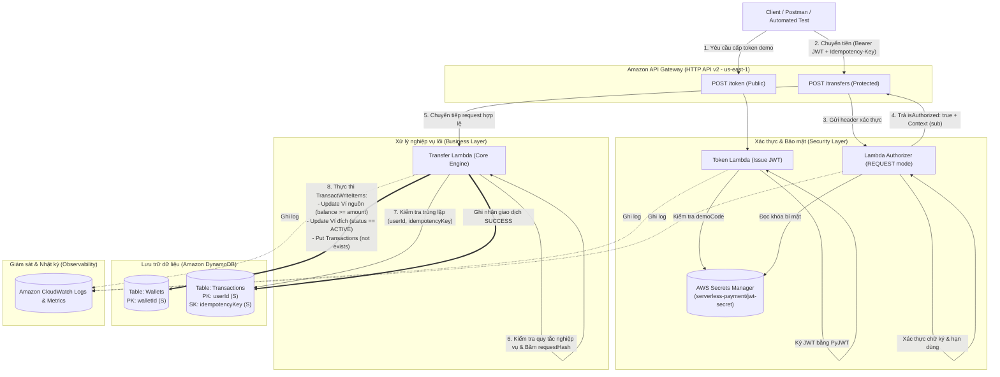

# KIẾN TRÚC HỆ THỐNG & QUYẾT ĐỊNH THIẾT KẾ (SYSTEM ARCHITECTURE & ADR)

> **Dự án:** Cổng thanh toán giả lập không máy chủ (`serverless-payment`)  
> **Học phần:** Cloud Computing – Đợt 1, Năm học 2026–2027  
> **GVHD:** ThS. Huỳnh Xuân Phụng  
> **Nhóm thực hiện:** Serverless (Vũ Minh Đức & Nguyễn Nguyên)  
> **Môi trường:** AWS Academy Learner Lab (`us-east-1`)  
> **Trạng thái:** Bản thiết kế hoàn chỉnh – Tuần 1  

---

## 1. Sơ đồ kiến trúc tổng thể (System Architecture)

Toàn bộ hệ thống được thiết kế theo mô hình **Pure Serverless (Hoàn toàn không máy chủ)**, tối ưu cho khả năng mở rộng tự động, độ trễ thấp và tiết kiệm tối đa chi phí hoạt động trên môi trường học tập AWS Learner Lab:



---

## 2. Luồng xử lý chi tiết (Interaction Flows)

### 2.1. Luồng cấp token demo (`POST /token`)
1. Client gửi yêu cầu kèm `userId` và `demoCode`.
2. `Token Lambda` đọc mã bí mật từ AWS Secrets Manager và đối chiếu với danh sách allowlist nội bộ.
3. Nếu hợp lệ, Lambda sử dụng thư viện **PyJWT** (thuật toán HS256) ký token có thời hạn 15 phút (`expiresIn: 900`).
4. Trả về `accessToken` dạng Bearer token cho client.

### 2.2. Luồng xác thực với Lambda Authorizer
1. Client gọi `POST /transfers` kèm header `Authorization: Bearer <token>`.
2. API Gateway HTTP API kích hoạt **Lambda Authorizer (REQUEST mode)**, Payload format 2.0.
3. Authorizer giải mã token, kiểm tra: chữ ký HMAC-SHA256, thời hạn hết hạn (`exp`), issuer và audience.
4. Nếu hợp lệ, Authorizer trả về:
   ```json
   {
     "isAuthorized": true,
     "context": {
       "userId": "user-a"
     }
   }
   ```
5. API Gateway gắn `context.userId` vào request chuyển tiếp sang Transfer Lambda, đảm bảo nghiệp vụ chỉ thao tác với người dùng đã được định danh an toàn.

### 2.3. Luồng chuyển tiền nguyên tử & Chống lặp (Core Transfer & Idempotency)
1. **Kiểm tra đầu vào:** Kiểm tra số tiền `amount` (số nguyên dương VND), kiểm tra mã ví nguồn khác ví đích.
2. **Định danh chủ sở hữu:** Đối chiếu quyền sở hữu ví nguồn với `userId` được cấp từ context của Authorizer.
3. **Tính toán `requestHash`:** Băm SHA-256 nội dung chuẩn hóa (`userId`, `fromWalletId`, `toWalletId`, `amount`, `currency`).
4. **Kiểm tra lịch sử Idempotency:**
   - Thực hiện `GetItem` (Strongly Consistent Read) trên bảng `Transactions` với cặp khóa `(userId, idempotencyKey)`.
   - **Trường hợp 1 (Đã thành công trước đó):** Nếu đã tồn tại và `requestHash` khớp $\rightarrow$ Trả về kết quả cũ kèm `replayed: true` (HTTP 200), không trừ thêm tiền.
   - **Trường hợp 2 (Xung đột key):** Nếu đã tồn tại nhưng `requestHash` khác $\rightarrow$ Trả về lỗi `409 IDEMPOTENCY_KEY_CONFLICT`.
   - **Trường hợp 3 (Giao dịch mới):** Tiếp tục bước thực thi nguyên tử.
5. **Thực thi `TransactWriteItems`:**
   - **Put Transactions:** Ghi bản ghi trạng thái `SUCCESS`, điều kiện `attribute_not_exists(userId)`.
   - **Update Ví nguồn:** Trừ tiền, điều kiện `attribute_exists(walletId) AND ownerId = :userId AND #status = :active AND balance >= :amount`.
   - **Update Ví đích:** Cộng tiền, điều kiện `attribute_exists(walletId) AND #status = :active AND currency = :vnd`.
6. **Kết quả:** Nếu tất cả điều kiện thỏa mãn, giao dịch commit đồng thời (HTTP 201 Created). Nếu có bất kỳ điều kiện nào vi phạm, toàn bộ giao dịch rollback về trạng thái ban đầu.

---

## 3. Nhật ký quyết định kiến trúc (Architecture Decision Records - ADR)

Các quyết định thiết kế then chốt được nhóm thống nhất nhằm tối ưu kỹ thuật và tuân thủ giới hạn của môi trường AWS Academy Learner Lab:

| Mã ADR | Hạng mục | Quyết định kỹ thuật | Cơ sở & Lợi ích |
|:---:|---|---|---|
| **ADR-01** | **AWS Region** | Sử dụng duy nhất **`us-east-1`** (US East - N. Virginia). | Tuân thủ chính sách của Learner Lab; tương thích đầy đủ tính năng của API Gateway HTTP API v2 và Secrets Manager. |
| **ADR-02** | **API Gateway Type** | Chọn **HTTP API (API Gateway v2)** thay cho REST API. | Giảm 70% chi phí, độ trễ thấp hơn (nhẹ hơn), hỗ trợ cơ chế Simple Response cho Lambda Authorizer (`isAuthorized: true/false`). |
| **ADR-03** | **Cơ sở dữ liệu** | Sử dụng **Amazon DynamoDB** (chế độ On-Demand Capacity). | Thuần serverless, không phát sinh chi phí duy trì cố định theo giờ; hỗ trợ giao dịch nguyên tử nhiều bảng qua `TransactWriteItems`. |
| **ADR-04** | **Kiểu dữ liệu tiền tệ** | Sử dụng **Số nguyên dương (Integer VND)**, loại bỏ hoàn toàn `float`. | Tránh lỗi làm tròn dấu phẩy động (floating-point error) thường gặp trong hệ thống tài chính; phù hợp với tiền tệ Việt Nam Đồng (không có xu). |
| **ADR-05** | **Tính nguyên tử (ACID)** | Gom 2 Update ví và 1 Put giao dịch vào **một lệnh `TransactWriteItems`**. | Bảo đảm tính bất biến tài chính: không bao giờ xảy ra lỗi trừ tiền một phía (zero balance discrepancy). |
| **ADR-06** | **Cơ chế Idempotency** | Sử dụng cặp khóa `(userId, idempotencyKey)` kết hợp `requestHash` (SHA-256) trong DynamoDB. | Khắc phục giới hạn 10 phút của `ClientRequestToken` trên DynamoDB; lưu vết chống gửi lặp vĩnh viễn trong cơ sở dữ liệu. |
| **ADR-07** | **Phạm vi lưu giao dịch** | Trong MVP, **chỉ ghi nhận giao dịch `SUCCESS`**. | Yêu cầu bị lỗi (thiếu số dư, sai ví) sẽ bị rollback và không chiếm key; cho phép client thử lại cùng key sau khi đã nạp đủ tiền hoặc sửa lỗi. |
| **ADR-08** | **Cơ chế Xác thực** | Tự sinh và kiểm tra JWT bằng thư viện **PyJWT (HS256)**, khóa bí mật lưu tại Secrets Manager. | Đúng yêu cầu đề bài (không dùng AWS Cognito); kiểm soát hoàn toàn vòng đời và claims của token. |
| **ADR-09** | **Quản lý hạ tầng & VPC** | **Không sử dụng VPC riêng, NAT Gateway hay EC2** cho các hàm Lambda. | Tránh phí duy trì NAT Gateway ($0.045/giờ); Lambda có thể gọi trực tiếp DynamoDB và Secrets Manager qua AWS internal network an toàn và miễn phí. |
| **ADR-10** | **Phân quyền IAM** | Tận dụng IAM Role có sẵn **`LabRole`** của Learner Lab. | Tuân thủ quy định môi trường học tập (không có quyền tạo IAM User hay IAM Role mới). |

---

## 4. Quy ước định danh tài nguyên (Resource Naming Conventions)

Chuẩn hóa tên gọi tài nguyên phục vụ việc triển khai tự động ở Tuần 2:

| Thành phần AWS | Quy ước đặt tên | Ghi chú |
|---|---|---|
| **API Gateway HTTP API** | `serverless-payment-api` | Endpoint HTTPS tại `us-east-1` |
| **Lambda Token** | `serverless-payment-token` | Xử lý `POST /token` |
| **Lambda Authorizer** | `serverless-payment-authorizer` | Lambda REQUEST Authorizer (Python 3.12, PyJWT) |
| **Lambda Transfer** | `serverless-payment-transfer` | Xử lý `POST /transfers` |
| **DynamoDB Wallets** | `Wallets` | PK: `walletId` (String) |
| **DynamoDB Transactions** | `Transactions` | PK: `userId` (String), SK: `idempotencyKey` (String) |
| **AWS Secrets Manager** | `serverless-payment/jwt-secret` | Lưu chuỗi bí mật HMAC ký JWT |
| **CloudWatch Log Groups** | `/aws/lambda/serverless-payment-*` | Thiết lập retention 7 ngày để tiết kiệm chi phí |

---

## 5. Quy chuẩn gắn thẻ (Tagging Policy)

Mọi tài nguyên được tạo ra trên AWS bắt buộc phải được gắn thẻ đầy đủ:
- `Project`: `serverless-payment`
- `Owner`: `Serverless-Team` (hoặc `VuMinhDuc` / `NguyenNguyen`)
- `Environment`: `Lab`
