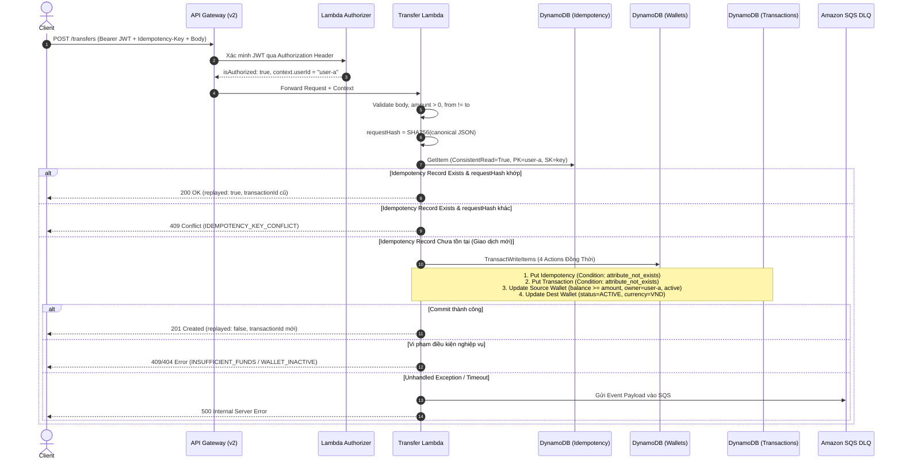

# KIẾN TRÚC HỆ THỐNG & QUYẾT ĐỊNH THIẾT KẾ (SYSTEM ARCHITECTURE & ADR)

> **Dự án:** Cổng thanh toán giả lập không máy chủ (`serverless-payment`)  
> **Học phần:** Cloud Computing – Đợt 1, Năm học 2026–2027  
> **GVHD:** ThS. Huỳnh Xuân Phụng  
> **Nhóm thực hiện:** Serverless (Vũ Minh Đức & Nguyễn Nguyên)  
> **Môi trường:** AWS Academy Learner Lab (`us-east-1`)  
> **Phiên bản:** 2.0 (Kiến trúc 3 bảng DynamoDB & 5 API Endpoints)  

---

## 1. Sơ đồ kiến trúc tổng thể (System Architecture)

Toàn bộ hệ thống được xây dựng theo mô hình **Pure Serverless (Hoàn toàn không máy chủ)**, tối ưu cho khả năng mở rộng tự động, độ trễ thấp, kiểm soát chi phí trong hạn mức Learner Lab $50 và đảm bảo tính toàn vẹn dữ liệu tài chính tuyệt đối:

```mermaid
flowchart TB
    Client["Client / Postman / Smoke Test"]

    subgraph APIGW["Amazon API Gateway (HTTP API v2 - us-east-1)"]
        Ingress["Ingress & Throttling Engine\n(Default: 10 RPS, Burst: 20)"]
        TokenRoute["POST /auth/token\n(Rate: 2 RPS, Burst: 5)"]
        TransferRoute["POST /transfers\n(Rate: 10 RPS, Burst: 20)"]
        WalletRoute["GET /wallets/{walletId}\n(Rate: 10 RPS, Burst: 20)"]
        TxRoute["GET /transactions/{transactionId}\n(Rate: 10 RPS, Burst: 20)"]
        HistoryRoute["GET /wallets/{walletId}/transactions\n(Rate: 10 RPS, Burst: 20)"]
    end

    subgraph Security["Xác thực & Bảo mật (Security Layer)"]
        AuthLambda["Lambda Authorizer (REQUEST mode)\n(PyJWT Layer - Python 3.12)"]
        TokenLambda["Token Lambda (Issue JWT)\n(PyJWT Layer - HS256)"]
        SecretsMgr[("AWS Secrets Manager\n(serverless-payment/jwt-secret)")]
    end

    subgraph Business["Xử lý nghiệp vụ lõi (Business Layer)"]
        TransferLambda["Transfer Lambda\n(Core Atomicity & Idempotency)"]
        WalletLambda["Wallet Query Lambda\n(Balance & History Pagination)"]
        TxLambda["Transaction Query Lambda\n(Transaction Detail by ID)"]
    end

    subgraph Database["Lưu trữ dữ liệu (Amazon DynamoDB - On Demand)"]
        WalletsTable[("Table: serverless-payment-wallets\nPK: walletId (S)")]
        TxTable[("Table: serverless-payment-transactions\nPK: transactionId (S)\nGSIs: FromWalletIndex, ToWalletIndex")]
        IdemTable[("Table: serverless-payment-idempotency\nPK: userId (S)\nSK: idempotencyKey (S)")]
    end

    subgraph Resilience["Khả năng phục hồi & Chịu lỗi (Resilience Layer)"]
        DLQ[("Amazon SQS: Dead Letter Queue\n(serverless-payment-dlq)")]
    end

    subgraph Monitoring["Giám sát & Nhật ký (Observability)"]
        CloudWatch[("Amazon CloudWatch Logs & Metrics\n(Retention: 7 days)")]
    end

    %% Ingress & Auth
    Client -->|"Gọi API"| Ingress
    Ingress -.->|"Vượt hạn mức RPS"| Client429["HTTP 429 Too Many Requests\n(Header: Retry-After)"]
    Ingress -->|"1. Cấp token demo (Public)"| TokenRoute
    TokenRoute --> TokenLambda
    TokenLambda -->|"Đọc demoAccessCode"| SecretsMgr
    TokenLambda -->|"Ký JWT (HS256)"| TokenLambda
    TokenLambda -.->|"Logs"| CloudWatch

    %% Protected Routes Authorizer
    Ingress -->|"2. Request kèm Bearer JWT"| TransferRoute & WalletRoute & TxRoute & HistoryRoute
    TransferRoute & WalletRoute & TxRoute & HistoryRoute -->|"3. Gửi header xác thực"| AuthLambda
    AuthLambda -->|"Đọc jwtSigningKey"| SecretsMgr
    AuthLambda -->|"Xác thực chữ ký & exp"| AuthLambda
    AuthLambda -->|"4. isAuthorized: true + Context (userId)"| APIGW
    AuthLambda -.->|"Logs"| CloudWatch

    %% Business routing
    TransferRoute -->|"5. Chuyển tiền nguyên tử"| TransferLambda
    WalletRoute -->|"Tra cứu số dư ví"| WalletLambda
    TxRoute -->|"Tra cứu giao dịch"| TxLambda
    HistoryRoute -->|"Lịch sử giao dịch (Phân trang)"| WalletLambda

    %% Transfer DynamoDB Flow
    TransferLambda -->|"Kiểm tra key cũ (Consistent Read)"| IdemTable
    TransferLambda ==>|"TransactWriteItems (4 Actions Đồng Thời):\n1. Put Idempotency Record\n2. Put Transaction Record\n3. Trừ số dư Ví nguồn\n4. Cộng số dư Ví đích"| Database
    TransferLambda -.->|"Unhandled exception / Timeout"| DLQ
    TransferLambda -.->|"Logs"| CloudWatch

    %% Query DynamoDB Flow
    WalletLambda -->|"GetItem (Kiểm tra ownerId == sub)"| WalletsTable
    WalletLambda -->|"Query GSIs + Cursor Pagination (nextToken)"| TxTable
    TxLambda -->|"GetItem (Kiểm tra participant == sub)"| TxTable
```



---

## 2. Luồng xử lý chi tiết (Interaction Flows)

### 2.1. Luồng cấp token demo (`POST /auth/token`)
1. **Client gửi yêu cầu:** POST `/auth/token` với payload chứa `userId` và `demoCode`.
2. **Kiểm tra Allowlist:** Chỉ cho phép các tài khoản demo hợp lệ (`user-a`, `user-b`).
3. **Xác thực mã an toàn:** Đọc `demoAccessCode` từ AWS Secrets Manager (`serverless-payment/jwt-secret`) và đối chiếu bằng hàm an toàn thời gian `hmac.compare_digest` nhằm loại bỏ hoàn toàn nguy cơ tấn công phân tích thời gian (timing attack).
4. **Ký JWT:** Sử dụng thư viện **PyJWT** ký token với thuật toán chuẩn **HS256**, thời hạn sống 900 giây (15 phút).
5. **Cấu trúc JWT Claims:**
   ```json
   {
     "sub": "user-a",
     "iss": "serverless-payment-demo",
     "aud": "payment-api",
     "iat": 1791676800,
     "exp": 1791677700,
     "jti": "550e8400-e29b-41d4-a716-446655440000"
   }
   ```
6. **Phản hồi:** Trả về `accessToken`, `tokenType: "Bearer"`, `expiresIn: 900` (HTTP 200).

---

### 2.2. Luồng xác thực & phân quyền với Lambda Authorizer (REQUEST mode)

Hệ thống **không sử dụng AWS Cognito** (tuân thủ giới hạn bài toán) và sử dụng **Lambda Authorizer tùy biến kết hợp PyJWT** thay vì Authorizer tích hợp sẵn để kiểm soát chặt chẽ toàn bộ logic xác thực:

#### Cấu hình Lambda Authorizer trên API Gateway HTTP API:

| Tham số cấu hình | Giá trị thiết lập | Mục đích kỹ thuật |
|---|---|---|
| **Authorizer Type** | `REQUEST` | Đọc toàn bộ request context bao gồm HTTP headers |
| **Payload Format** | `2.0` | Định dạng chuẩn tối ưu hóa cho HTTP API v2 |
| **Identity Source** | `$request.header.Authorization` | Tự động kích hoạt khi có header `Authorization` |
| **Simple Responses** | Enabled | Trả về định dạng gọn nhẹ `{"isAuthorized": true/false}` |
| **Authorizer Caching** | Disabled (TTL = 0) | Tránh rủi ro cache token hết hạn trong lúc kiểm thử |
| **Context Payload** | `context.userId = sub` | Truyền định danh người dùng đã xác minh sang backend |

#### Quản lý khóa trên AWS Secrets Manager:
Secret định danh: `serverless-payment/jwt-secret` tại Region `us-east-1`:
```json
{
  "jwtSigningKey": "c3VwZXItc2VjcmV0LWtleS1mb3Itc2VydmVybGVzcy1wYXltZW50LTIwMjY=",
  "demoAccessCode": "spg-demo-code-2026"
}
```
Mã nguồn Lambda truy xuất trực tiếp qua AWS SDK (`boto3`) với quyền của `LabRole`. Tuyệt đối không commit khóa vào kho lưu trữ Git.

#### Cơ chế xác minh token:
1. Trích xuất Bearer token từ header `Authorization`.
2. Kiểm tra chữ ký với thuật toán cố định `algorithms=["HS256"]` (không tin `alg` do client tự khai trong header token).
3. Kiểm tra tính hợp lệ của các claims: `exp` (chưa hết hạn), `iss == "serverless-payment-demo"`, `aud == "payment-api"`, `sub` tồn tại.
4. Khi hợp lệ, trả về Simple Response:
   ```json
   {
     "isAuthorized": true,
     "context": {
       "userId": "user-a"
     }
   }
   ```
5. Backend Lambdas (`transfer`, `wallet_query`, `transaction_query`) trích xuất định danh người dùng qua `event["requestContext"]["authorizer"]["lambda"]["userId"]`. Hệ thống tuyệt đối không tin cậy `userId` do client tự truyền trong body hoặc URL query.

#### Ma trận xử lý lỗi xác thực & phân quyền:
| Kịch bản kiểm thử | Hành vi hệ thống | HTTP Status Code |
|---|---|---|
| Không gửi header `Authorization` | API Gateway từ chối ngay lập tức | `401 Unauthorized` |
| Header không đúng định dạng `Bearer <token>` | Lambda Authorizer từ chối ủy quyền | `403 Forbidden` |
| Token hết hạn (`exp` quá hạn) | Lambda Authorizer xác thực thất bại | `403 Forbidden` |
| Chữ ký HMAC sai hoặc bị chỉnh sửa | Lambda Authorizer phát hiện chữ ký lỗi | `403 Forbidden` |
| Token sai Issuer hoặc Audience | Lambda Authorizer từ chối ủy quyền | `403 Forbidden` |
| Token hợp lệ nhưng thao tác ví của người khác | Backend Lambda kiểm tra `sub != ownerId` | `403 Forbidden` |
| Token hợp lệ, ví nguồn chính chủ | Chấp thuận thực thi giao dịch | Cho phép xử lý |

---

### 2.3. Luồng chuyển tiền nguyên tử & Chống trùng lặp (Transfer & Idempotency)

Xử lý giao dịch tại `serverless-payment-transfer` tuân thủ nguyên tắc ACID và phòng vệ Idempotency vĩnh viễn:



#### Chi tiết 4 hành động trong `TransactWriteItems`:
1. **Put vào `serverless-payment-idempotency`:**
   - Điều kiện: `attribute_not_exists(userId) AND attribute_not_exists(idempotencyKey)`.
   - Lưu trữ: `userId`, `idempotencyKey`, `requestHash`, `transactionId`, `createdAt`.
2. **Put vào `serverless-payment-transactions`:**
   - Điều kiện: `attribute_not_exists(transactionId)`.
   - Lưu trữ: `transactionId`, `fromWalletId`, `toWalletId`, `amount`, `currency`, `timeKey`, `createdAt`, `status: "SUCCESS"`.
3. **Update ví nguồn trong `serverless-payment-wallets`:**
   - Biểu thức: `SET balance = balance - :amount, updatedAt = :now`.
   - Điều kiện: `attribute_exists(walletId) AND ownerId = :sub AND #st = :active AND currency = :vnd AND balance >= :amount`.
4. **Update ví đích trong `serverless-payment-wallets`:**
   - Biểu thức: `SET balance = balance + :amount, updatedAt = :now`.
   - Điều kiện: `attribute_exists(walletId) AND #st = :active AND currency = :vnd`.

Nếu bất kỳ hành động nào trong 4 thao tác trên không thỏa mãn điều kiện, toàn bộ giao dịch lập tức bị hủy bỏ (100% Rollback), đảm bảo tuyệt đối không có hiện tượng trừ tiền một phía.

---

### 2.4. Luồng tra cứu ví & Lịch sử giao dịch (Query Flows)

#### Tra cứu ví (`GET /wallets/{walletId}`):
- Thực hiện bởi hàm `serverless-payment-wallet-query`.
- Đọc thông tin ví từ bảng `serverless-payment-wallets`.
- Kiểm tra quyền sở hữu nghiêm ngặt: nếu `item["ownerId"] != sub`, trả về ngay **`403 Forbidden`**.

#### Tra cứu chi tiết giao dịch (`GET /transactions/{transactionId}`):
- Thực hiện bởi hàm `serverless-payment-transaction-query`.
- Đọc thông tin giao dịch từ bảng `serverless-payment-transactions`.
- Tra cứu ví nguồn và ví đích trong `serverless-payment-wallets`: chỉ người dùng sở hữu ví nguồn hoặc ví đích mới có quyền xem (`sub in (sourceOwner, destOwner)`). Nếu là bên thứ ba, từ chối với **`403 Forbidden`**.

#### Tra cứu lịch sử giao dịch có phân trang (`GET /wallets/{walletId}/transactions`):
- Thực hiện bởi hàm `serverless-payment-wallet-query`.
- Kiểm tra quyền sở hữu ví `walletId` của người gọi (`ownerId == sub`).
- Thực hiện truy vấn trên 2 Global Secondary Indexes (GSIs):
  - `FromWalletIndex`: HASH: `fromWalletId`, RANGE: `timeKey` (giao dịch chuyển đi).
  - `ToWalletIndex`: HASH: `toWalletId`, RANGE: `timeKey` (giao dịch nhận về).
- Kết hợp dữ liệu (merge) và sắp xếp giảm dần theo thời gian (`ScanIndexForward=False`).
- Hỗ trợ tham số phân trang: `limit` (tối đa 50, mặc định 20) và con trỏ `nextToken` (mã hóa Base64 chuỗi JSON `ExclusiveStartKey`).

---

### 2.5. Luồng kiểm soát lưu lượng (Rate Limiting & Throttling)
- **Mục đích:** Bảo vệ API khỏi nguy cơ brute-force mã demo và quá tải hệ thống backend.
- **Cấu hình trên API Gateway HTTP API v2:**
  - **Stage Default:** Rate Limit = 10 requests/giây (RPS), Burst Limit = 20 requests.
  - **Route `POST /auth/token`:** Rate Limit = 2 RPS, Burst Limit = 5.
  - **Route `POST /transfers`:** Rate Limit = 10 RPS, Burst Limit = 20.
- **Phản hồi:** Khi lưu lượng vượt ngưỡng, API Gateway từ chối ngay tại tầng biên với mã **`429 Too Many Requests`** kèm header `Retry-After`. Thao tác chặn này diễn ra trước khi kích hoạt Lambda, tiết kiệm 100% chi phí tính toán backend.

---

### 2.6. Luồng hàng đợi chết (Dead Letter Queue - SQS DLQ)
- **Mục đích:** Đảm bảo không bao giờ làm mất dấu vết giao dịch khi backend gặp lỗi unhandled exception hoặc timeout.
- **Cấu hình:** Hàng đợi Amazon SQS Standard `serverless-payment-dlq` (Message Retention: 14 ngày).
- **Cơ chế:** Khi hàm `Transfer Lambda` gặp lỗi ngoại lệ chưa xử lý, toàn bộ thông điệp sự kiện gốc được ghi nhận vào SQS DLQ phục vụ đối soát, kiểm toán và khôi phục thủ công.
- **Cảnh báo:** CloudWatch Alarm theo dõi chỉ số `ApproximateNumberOfMessagesVisible` phát hiện tức thì khi có sự cố.

---

## 3. Nhật ký quyết định kiến trúc (Architecture Decision Records - ADR)

| Mã ADR | Hạng mục | Quyết định kỹ thuật | Cơ sở & Lợi ích |
|:---:|---|---|---|
| **ADR-01** | **AWS Region** | Sử dụng duy nhất **`us-east-1`** (US East - N. Virginia). | Tuân thủ chính sách của Learner Lab; tương thích toàn diện API Gateway HTTP API v2, Secrets Manager và DynamoDB On-Demand. |
| **ADR-02** | **API Gateway Type** | Chọn **HTTP API (API Gateway v2)** thay cho REST API. | Giảm 70% chi phí, độ trễ thấp hơn, hỗ trợ cơ chế Simple Response cho Lambda Authorizer (`isAuthorized: true/false`). |
| **ADR-03** | **Cơ sở dữ liệu** | Sử dụng **3 bảng DynamoDB On-Demand** (`wallets`, `transactions`, `idempotency`). | Tách biệt ranh giới thực thể, tránh quá tải khóa phân vùng (hot partition), quản lý chỉ mục GSI độc lập và tối ưu chi phí (0 đồng khi không có truy vấn). |
| **ADR-04** | **Kiểu dữ liệu tiền tệ** | Sử dụng **Số nguyên dương (Integer VND)**, loại bỏ `float`. | Tránh lỗi làm tròn dấu phẩy động trong giao dịch tài chính; tương thích với đồng tiền Việt Nam (không có đơn vị tiền tệ thập phân). |
| **ADR-05** | **Tính nguyên tử (ACID)** | Gom 4 thao tác vào **một lệnh `TransactWriteItems` duy nhất**. | Đảm bảo tính nhất quán tuyệt đối: không bao giờ trừ tiền một phía (zero balance discrepancy) và commit đồng thời với bản ghi idempotency. |
| **ADR-06** | **Chỉ mục phụ (GSIs)** | Thiết kế 2 GSIs `FromWalletIndex` và `ToWalletIndex` với sort key `timeKey` (`<createdAt>#<txId>`). | Cho phép tra cứu lịch sử chuyển đi và nhận về theo từng ví với độ phức tạp $O(1)$ mà không cần scan toàn bộ bảng giao dịch. |
| **ADR-07** | **Phạm vi Idempotency** | Lưu vết bằng bảng riêng `serverless-payment-idempotency` kết hợp `requestHash` (SHA-256). | Khắc phục giới hạn 10 phút của `ClientRequestToken` trên DynamoDB; bảo đảm chống gửi lặp vĩnh viễn trong CSDL. |
| **ADR-08** | **Cơ chế Xác thực** | Tự phát hành và kiểm tra JWT bằng thư viện **PyJWT (HS256)**, khóa lưu tại Secrets Manager. | Đúng yêu cầu đề tài (không dùng Cognito); kiểm soát hoàn toàn claims và loại bỏ nguy cơ phụ thuộc dịch vụ trả phí cao. |
| **ADR-09** | **Mạng & Hạ tầng** | **Không dùng VPC riêng, NAT Gateway hay EC2** cho Lambda. | Tiết kiệm chi phí (tránh phí duy trì NAT Gateway $0.045/giờ); Lambda truy xuất DynamoDB và Secrets Manager qua mạng nội bộ AWS an toàn và miễn phí. |
| **ADR-10** | **Phân quyền IAM** | Tận dụng IAM Execution Role có sẵn **`LabRole`** của Learner Lab. | Tuân thủ chính sách bảo mật môi trường học tập (không có quyền tạo mới IAM Role). |
| **ADR-11** | **Kiểm soát lưu lượng** | Cấu hình **Stage & Route Throttling** trên HTTP API (Token: 2 RPS / Burst 5; Transfers: 10 RPS / Burst 20). | Chống DoS, chống brute-force mã demo, từ chối sớm tại biên HTTP với mã 429 giúp tiết kiệm 100% tài nguyên tính toán backend. |
| **ADR-12** | **Khả năng chịu lỗi** | Tích hợp **Amazon SQS Dead Letter Queue (`serverless-payment-dlq`)** cho Transfer Lambda. | Lưu giữ vết toàn bộ giao dịch lỗi ngoại lệ hạ tầng không lường trước để đối soát, nằm trọn trong hạn mức miễn phí (Free Tier) của SQS. |
| **ADR-13** | **Phân trang lịch sử** | Sử dụng **Cursor-based Pagination** qua `limit` (1..50) và `nextToken` (Base64 JSON của `ExclusiveStartKey`). | Tránh quét tràn bộ nhớ, độ trễ ổn định khi số lượng giao dịch tăng cao, tương thích chuẩn DynamoDB pagination. |
| **ADR-14** | **Phân tách hàm tra cứu** | Tách riêng hàm `wallet_query` và `transaction_query` với kiểm tra quyền chủ sở hữu nghiêm ngặt. | Nguyên tắc phân quyền tối thiểu (Least Privilege): chỉ chủ ví hoặc người tham gia giao dịch mới được truy xuất dữ liệu số dư và lịch sử. |

---

## 4. Quy ước định danh tài nguyên (Resource Naming Conventions)

| Thành phần AWS | Tên định danh tài nguyên | Ghi chú kỹ thuật |
|---|---|---|
| **API Gateway HTTP API** | `serverless-payment-api` | HTTP API v2 tại `us-east-1` (tích hợp Route Throttling) |
| **Lambda Token** | `serverless-payment-token` | Xử lý `POST /auth/token`, đính kèm PyJWT Layer |
| **Lambda Authorizer** | `serverless-payment-authorizer` | Lambda REQUEST Authorizer (Python 3.12, PyJWT Layer) |
| **Lambda Transfer** | `serverless-payment-transfer` | Xử lý `POST /transfers`, 4 actions TransactWriteItems |
| **Lambda Wallet Query** | `serverless-payment-wallet-query` | Xử lý `GET /wallets/{id}` và `GET /wallets/{id}/transactions` |
| **Lambda Tx Query** | `serverless-payment-transaction-query` | Xử lý `GET /transactions/{id}` |
| **DynamoDB Wallets** | `serverless-payment-wallets` | PK: `walletId` (String), BillingMode: On-Demand |
| **DynamoDB Transactions** | `serverless-payment-transactions` | PK: `transactionId` (String), GSIs: `FromWalletIndex`, `ToWalletIndex` |
| **DynamoDB Idempotency** | `serverless-payment-idempotency` | PK: `userId` (String), SK: `idempotencyKey` (String) |
| **Amazon SQS DLQ** | `serverless-payment-dlq` | Dead Letter Queue lưu vết giao dịch lỗi hệ thống |
| **AWS Secrets Manager** | `serverless-payment/jwt-secret` | Lưu JSON chứa `jwtSigningKey` và `demoAccessCode` |
| **CloudWatch Log Groups** | `/aws/lambda/serverless-payment-*` | Thời gian lưu trữ (retention) 7 ngày |

---

## 5. Quy chuẩn gắn thẻ (Tagging Policy)

Mọi tài nguyên được tạo ra trên AWS bắt buộc phải được gắn thẻ đầy đủ:
- `Project`: `serverless-payment`
- `Owner`: `Serverless-Team` (hoặc `VuMinhDuc` / `NguyenNguyen`)
- `Environment`: `Lab`
