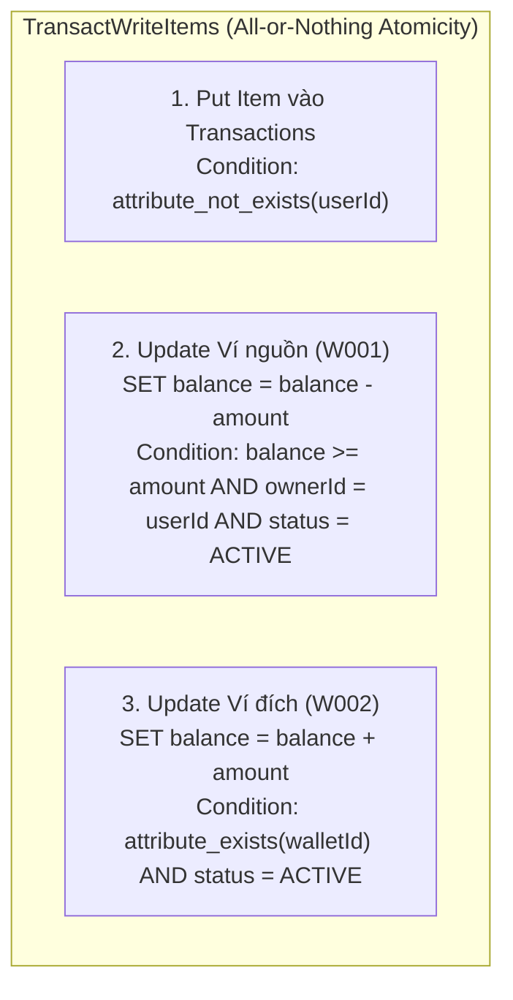

# THIẾT KẾ CƠ SỞ DỮ LIỆU DYNAMODB & GIAO DỊCH ACID (DATA MODEL & TRANSACTIONS)

> **Học phần:** Cloud Computing (Điện toán đám mây) – Đợt 1, Năm học 2026–2027  
> **Dự án:** Cổng thanh toán giả lập không máy chủ (`serverless-payment`)  
> **Người thực hiện:** Vũ Minh Đức  
> **Phối hợp thực hiện:** Nguyễn Nguyên  
> **AWS Region:** `us-east-1` · **Chế độ Capacity:** On-Demand (Pay-Per-Request)  
> **Phiên bản:** 1.0 (Giai đoạn Thiết kế – Tuần 1)  

---

## 1. Bảng `Wallets` (Quản lý tài khoản và số dư ví)

Bảng `Wallets` lưu trữ số dư và trạng thái tài khoản. Chế độ thanh toán theo yêu cầu (On-Demand) giúp tối ưu hóa hoàn toàn chi phí trên AWS Learner Lab:

### 1.1. Cấu trúc thuộc tính (Schema Definition)

| Thuộc tính | Kiểu dữ liệu DynamoDB | Ràng buộc kỹ thuật | Ý nghĩa & Mục đích sử dụng |
|---|:---:|---|---|
| `walletId` | `S` (String) | **Partition Key (PK)** | Mã định danh duy nhất của ví (ví dụ: `W001`, `W002`). |
| `ownerId` | `S` (String) | Bắt buộc, Indexed logic | ID chủ sở hữu ví (khớp với claim `sub` trong JWT). |
| `balance` | `N` (Number) | Số nguyên dương, $\ge 0$ | Số dư khả dụng bằng VND (không dùng số thực / float). |
| `currency` | `S` (String) | Cố định `VND` | Loại tiền tệ của ví. |
| `status` | `S` (String) | `ACTIVE` \| `SUSPENDED` | Trạng thái hoạt động của ví. |
| `createdAt` | `S` (String) | Chuẩn ISO 8601 UTC | Thời điểm tạo ví ban đầu. |
| `updatedAt` | `S` (String) | Chuẩn ISO 8601 UTC | Thời điểm cập nhật số dư gần nhất. |

### 1.2. Bản ghi mẫu khởi tạo (Seed Data)
```json
{
  "walletId": "W001",
  "ownerId": "user-a",
  "balance": 100000,
  "currency": "VND",
  "status": "ACTIVE",
  "createdAt": "2026-10-10T00:00:00Z",
  "updatedAt": "2026-10-10T00:00:00Z"
}
```

---

## 2. Bảng `Transactions` (Lịch sử giao dịch & Idempotency Store)

Bảng `Transactions` đóng vai trò kép: vừa là sổ cái ghi nhận các giao dịch thanh toán thành công, vừa là kho lưu trữ khóa Idempotency để chống gửi lặp request vĩnh viễn:

### 2.1. Cấu trúc thuộc tính (Schema Definition)

| Thuộc tính | Kiểu dữ liệu DynamoDB | Ràng buộc kỹ thuật | Ý nghĩa & Mục đích sử dụng |
|---|:---:|---|---|
| `userId` | `S` (String) | **Partition Key (PK)** | ID người dùng thực hiện giao dịch (lấy từ JWT `sub`). |
| `idempotencyKey` | `S` (String) | **Sort Key (SK)** | Khóa chống lặp do client sinh (UUID v4, tối đa 36 ký tự). |
| `transactionId` | `S` (String) | UUID v4 | Mã giao dịch hệ thống sinh ra ngẫu nhiên khi commit. |
| `requestHash` | `S` (String) | Chuỗi hex 64 ký tự | Mã băm SHA-256 từ nội dung payload đã chuẩn hóa. |
| `fromWalletId` | `S` (String) | Tham chiếu `Wallets` | Ví nguồn chuyển tiền đi. |
| `toWalletId` | `S` (String) | Tham chiếu `Wallets` | Ví đích nhận tiền đến. |
| `amount` | `N` (Number) | Số nguyên dương | Số tiền chuyển tính theo đơn vị VND. |
| `currency` | `S` (String) | Cố định `VND` | Loại tiền tệ của giao dịch. |
| `status` | `S` (String) | `SUCCESS` | Trạng thái giao dịch (MVP chỉ lưu giao dịch đã commit). |
| `createdAt` | `S` (String) | Chuẩn ISO 8601 UTC | Thời điểm giao dịch được ghi nhận thành công. |

### 2.2. Khóa chính phức hợp & Phân vùng dữ liệu
- Bằng cách chọn cặp khóa `(userId, idempotencyKey)` làm Primary Key, hệ thống tự động cô lập không gian khóa chống lặp giữa các người dùng khác nhau. User B sử dụng cùng chuỗi UUID với User A sẽ không gây xung đột khóa.
- Truy vấn kiểm tra chống lặp thực hiện bằng thao tác `GetItem` với tùy chọn `ConsistentRead=True`, bảo đảm đọc dữ liệu nhất quán mạnh tức thì mà không cần tạo chỉ mục phụ GSI tốn kém.

---

## 3. Thuật toán chuẩn hóa Payload (Canonical Request & `requestHash`)

Để phát hiện chính xác trường hợp client sử dụng lại `Idempotency-Key` nhưng gửi nội dung giao dịch khác, hệ thống áp dụng cơ chế băm dữ liệu chuẩn hóa:

1. **Trích xuất các trường cốt lõi:** Chỉ trích xuất 5 trường quyết định tính chất giao dịch: `userId`, `fromWalletId`, `toWalletId`, `amount`, `currency`. Loại bỏ các trường biến động như thời gian gửi `timestamp`.
2. **Sắp xếp khóa theo bảng chữ cái (Alphabetical Sort):** Đảm bảo thứ tự xuất hiện của các trường trong chuỗi JSON luôn cố định.
3. **Mã hóa JSON thu gọn (Minified JSON):** Loại bỏ toàn bộ dấu cách thừa (`separators=(',', ':')`).
4. **Băm SHA-256:** Tính toán chuỗi băm hex 64 ký tự.

```python
import hashlib
import json

def compute_request_hash(user_id: str, from_wallet: str, to_wallet: str, amount: int, currency: str = "VND") -> str:
    canonical_data = {
        "amount": amount,
        "currency": currency,
        "fromWalletId": from_wallet,
        "toWalletId": to_wallet,
        "userId": user_id
    }
    canonical_str = json.dumps(canonical_data, sort_keys=True, separators=(',', ':'))
    return hashlib.sha256(canonical_str.encode('utf-8')).hexdigest()
```

---

## 4. Giao dịch nguyên tử với `TransactWriteItems`

Mọi giao dịch chuyển tiền phải thực thi đồng thời cả 03 hành động trong một lệnh gọi `TransactWriteItems` duy nhất của DynamoDB:



### 4.1. Chi tiết 03 thao tác trong transaction:

1. **Ghi bản ghi giao dịch (Put Transactions):**
   - Lưu trữ bản ghi giao dịch thành công.
   - Điều kiện: `attribute_not_exists(userId)` $\rightarrow$ Ngăn chặn ghi đè nếu đã tồn tại bản ghi với cùng `(userId, idempotencyKey)`.

2. **Khấu trừ số dư ví nguồn (Update Source Wallet):**
   - Lệnh: `SET balance = balance - :amount, updatedAt = :now`
   - Điều kiện (`ConditionExpression`):
     ```text
     attribute_exists(walletId) 
     AND ownerId = :userId 
     AND #status = :active 
     AND currency = :vnd 
     AND balance >= :amount
     ```

3. **Cộng số dư ví đích (Update Destination Wallet):**
   - Lệnh: `SET balance = balance + :amount, updatedAt = :now`
   - Điều kiện (`ConditionExpression`):
     ```text
     attribute_exists(walletId) 
     AND #status = :active 
     AND currency = :vnd
     ```
   - *Lưu ý quan trọng:* Bắt buộc kiểm tra `attribute_exists(walletId)` vì mặc định lệnh `UpdateItem` của DynamoDB sẽ tự động tạo mới item nếu khóa chưa tồn tại.

---

## 5. Xử lý tranh chấp đồng thời & Khôi phục Idempotency

1. **Bước 1 (Đọc kiểm tra trước):** Đọc nhất quán (`ConsistentRead=True`) bản ghi `(userId, idempotencyKey)` trên bảng `Transactions`.
   - Nếu tìm thấy bản ghi cũ và `requestHash` trùng khớp $\rightarrow$ Trả về kết quả giao dịch trước đó kèm `replayed: true` (HTTP 200 OK), không trừ tiền lần hai.
   - Nếu tìm thấy bản ghi cũ nhưng `requestHash` khác $\rightarrow$ Trả về lỗi `409 IDEMPOTENCY_KEY_CONFLICT`.
2. **Bước 2 (Thực thi giao dịch mới):** Nếu chưa có bản ghi, thực hiện lệnh `TransactWriteItems`.
3. **Bước 3 (Xử lý biệt lệ `TransactionCanceledException`):**
   - Nếu do điều kiện số dư không đủ (`balance < amount`) $\rightarrow$ Trả về `409 INSUFFICIENT_FUNDS`. Không lưu bản ghi vào `Transactions`.
   - Nếu do xung đột transaction đồng thời từ luồng khác $\rightarrow$ Đọc lại bảng `Transactions` để kiểm tra xem request song song đã kịp hoàn tất hay chưa, xử lý retry có giới hạn (exponential backoff).
