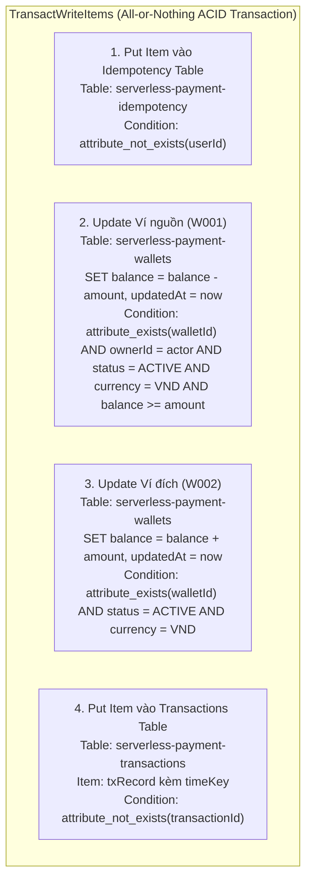

# THIẾT KẾ CƠ SỞ DỮ LIỆU DYNAMODB & GIAO DỊCH ACID (DATA MODEL & TRANSACTIONS)

> **Học phần:** Cloud Computing (Điện toán đám mây) – Đợt 1, Năm học 2026–2027  
> **Dự án:** Cổng thanh toán giả lập không máy chủ (`serverless-payment`)  
> **Người thực hiện:** Vũ Minh Đức  
> **Phối hợp thực hiện:** Nguyễn Nguyên  
> **AWS Region:** `us-east-1` · **Chế độ Capacity:** On-Demand (Pay-Per-Request)  
> **Phiên bản:** 2.0 (Kiến trúc 3 bảng chuyên biệt & 2 GSIs)  

---

## 1. Tổng quan kiến trúc 3 Bảng DynamoDB

Hệ thống sử dụng **03 bảng DynamoDB chuyên biệt** thay vì dồn chung, kết hợp chế độ thanh toán theo yêu cầu (**On-Demand Capacity Mode**) nhằm bảo đảm:
1. **Tuân thủ nguyên tắc chuẩn hóa dữ liệu & trách nhiệm đơn lẻ (Single Responsibility):** Tách biệt rõ ràng giữa quản lý số dư ví, nhật ký giao dịch tài chính, và kho lưu trữ chống trùng lặp yêu cầu.
2. **Hiệu năng & Tối ưu chi phí:** Tránh scan toàn bảng, mọi truy vấn đều đạt độ phức tạp $O(1)$ hoặc $O(\log N)$ qua Primary Key hoặc Global Secondary Index (GSI).
3. **Tính nguyên tử tài chính (ACID):** Thực thi lệnh `TransactWriteItems` đồng thời trên cả 3 bảng với 4 hành động (All-or-Nothing).

```
Amazon DynamoDB (us-east-1, On-Demand)
├── serverless-payment-wallets         (Quản lý ví & số dư)
├── serverless-payment-transactions    (Nhật ký giao dịch + 2 GSIs)
└── serverless-payment-idempotency     (Kho lưu khóa chống trùng lặp)
```

---

## 2. Chi tiết cấu trúc từng bảng

### 2.1. Bảng `serverless-payment-wallets` (Quản lý tài khoản & Số dư ví)
Lưu trữ thông tin định danh, chủ sở hữu, trạng thái và số dư khả dụng của các ví điện tử trong hệ thống:

| Thuộc tính | Kiểu dữ liệu | Vai trò / Ràng buộc kỹ thuật | Ý nghĩa & Mục đích sử dụng |
|---|:---:|---|---|
| `walletId` | `S` (String) | **Partition Key (PK)** | Mã định danh duy nhất của ví (ví dụ: `W001`, `W002`, regex `^[A-Za-z0-9_-]{1,64}$`). |
| `ownerId` | `S` (String) | Bắt buộc | ID chủ sở hữu ví (khớp với claim `sub` trong JWT, ví dụ: `user-a`, `user-b`). |
| `balance` | `N` (Number) | Bắt buộc, số nguyên $\ge 0$ | Số dư khả dụng tính theo đơn vị VND (không dùng số thực float). |
| `currency` | `S` (String) | Cố định `VND` (hoặc `USD`) | Loại tiền tệ của ví. |
| `status` | `S` (String) | `ACTIVE` \| `SUSPENDED` | Trạng thái hoạt động của ví. Chỉ ví `ACTIVE` mới được giao dịch. |
| `createdAt` | `S` (String) | Chuẩn ISO 8601 UTC | Thời điểm tạo ví ban đầu. |
| `updatedAt` | `S` (String) | Chuẩn ISO 8601 UTC | Thời điểm cập nhật số dư gần nhất. |

**Bản ghi mẫu (Seed Data):**
```json
{
  "walletId": "W001",
  "ownerId": "user-a",
  "balance": 100000,
  "currency": "VND",
  "status": "ACTIVE",
  "createdAt": "2026-10-22T00:00:00Z",
  "updatedAt": "2026-10-22T00:00:00Z"
}
```

---

### 2.2. Bảng `serverless-payment-transactions` (Nhật ký giao dịch tài chính)
Lưu trữ toàn bộ các giao dịch chuyển tiền đã cam kết thành công (`SUCCESS`). Hỗ trợ tra cứu chi tiết và truy vấn lịch sử hai chiều qua Global Secondary Indexes (GSIs):

| Thuộc tính | Kiểu dữ liệu | Vai trò / Ràng buộc kỹ thuật | Ý nghĩa & Mục đích sử dụng |
|---|:---:|---|---|
| `transactionId` | `S` (String) | **Partition Key (PK)** | Mã định danh giao dịch duy nhất do hệ thống sinh (UUID v4). |
| `userId` | `S` (String) | Bắt buộc | Định danh người gửi (lấy từ claim `sub` của JWT). |
| `fromWalletId` | `S` (String) | GSI HASH Key (`FromWalletIndex`) | Mã ví nguồn chuyển tiền đi. |
| `toWalletId` | `S` (String) | GSI HASH Key (`ToWalletIndex`) | Mã ví đích nhận tiền đến. |
| `amount` | `N` (Number) | Bắt buộc, số nguyên dương | Số tiền chuyển (VND). |
| `currency` | `S` (String) | Cố định `VND` | Loại tiền tệ của giao dịch. |
| `status` | `S` (String) | `SUCCESS` | Trạng thái giao dịch (chỉ ghi nhận khi commit thành công). |
| `createdAt` | `S` (String) | Chuẩn ISO 8601 UTC | Thời điểm giao dịch hoàn thành. |
| `timeKey` | `S` (String) | GSI RANGE Key (cả 2 GSIs) | Chuỗi kết hợp dạng `<createdAt>#<transactionId>` phục vụ sắp xếp thời gian. |

#### Chỉ mục phụ toàn cục (Global Secondary Indexes - GSIs):
Để phục vụ endpoint `GET /wallets/{walletId}/transactions` tra cứu lịch sử tiền đi và tiền đến có phân trang:
1. **`FromWalletIndex`:**
   - **Partition Key (HASH):** `fromWalletId`
   - **Sort Key (RANGE):** `timeKey`
   - **Projection:** `ALL`
   - **Mục đích:** Truy vấn danh sách các giao dịch chuyển tiền đi (`OUTGOING`) của một ví theo thời gian giảm dần.
2. **`ToWalletIndex`:**
   - **Partition Key (HASH):** `toWalletId`
   - **Sort Key (RANGE):** `timeKey`
   - **Projection:** `ALL`
   - **Mục đích:** Truy vấn danh sách các giao dịch nhận tiền đến (`INCOMING`) của một ví theo thời gian giảm dần.

---

### 2.3. Bảng `serverless-payment-idempotency` (Kho khóa chống trùng lặp)
Lưu trữ thông tin khóa chống lặp yêu cầu nhằm bảo đảm không bao giờ trừ tiền hai lần khi client gửi lại request:

| Thuộc tính | Kiểu dữ liệu | Vai trò / Ràng buộc kỹ thuật | Ý nghĩa & Mục đích sử dụng |
|---|:---:|---|---|
| `userId` | `S` (String) | **Partition Key (PK)** | Định danh người dùng (lấy từ JWT `sub`). Tách biệt không gian khóa giữa các user. |
| `idempotencyKey` | `S` (String) | **Sort Key (SK)** | Khóa chống lặp do client sinh (UUID v4, tối đa 36 ký tự). |
| `requestHash` | `S` (String) | Chuỗi hex SHA-256 (64 ký tự) | Mã băm chuẩn hóa 5 trường thông tin cốt lõi của request. |
| `transactionId` | `S` (String) | UUID v4 | Mã giao dịch tương ứng đã thực hiện thành công. |
| `fromWalletId` | `S` (String) | String | Ví nguồn của giao dịch đã lưu. |
| `toWalletId` | `S` (String) | String | Ví đích của giao dịch đã lưu. |
| `amount` | `N` (Number) | Number | Số tiền đã chuyển. |
| `currency` | `S` (String) | Cố định `VND` | Tiền tệ. |
| `status` | `S` (String) | `SUCCESS` | Trạng thái. |
| `createdAt` | `S` (String) | Chuẩn ISO 8601 UTC | Thời điểm ghi nhận. |

---

## 3. Thuật toán chuẩn hóa Payload (Canonical Request & `requestHash`)

Để phát hiện chính xác trường hợp client sử dụng lại `Idempotency-Key` nhưng gửi số tiền hoặc ví khác, hệ thống áp dụng cơ chế băm dữ liệu chuẩn hóa:
1. **Trích xuất 5 trường cốt lõi:** `userId`, `fromWalletId`, `toWalletId`, `amount`, `currency` (bỏ qua timestamp, headers biến động).
2. **Sắp xếp khóa bảng chữ cái (`sort_keys=True`):** Đảm bảo thứ tự key JSON cố định.
3. **Nén JSON thu gọn (`separators=(',', ':')`):** Loại bỏ toàn bộ khoảng trắng thừa.
4. **Băm SHA-256:** Sinh mã băm 64 ký tự hex.

```python
import hashlib
import json

def request_hash(user_id, src, dest, amount):
    content = {
        'userId': user_id,
        'fromWalletId': src,
        'toWalletId': dest,
        'amount': amount,
        'currency': 'VND'
    }
    canonical = json.dumps(content, sort_keys=True, ensure_ascii=False, separators=(',', ':'))
    return hashlib.sha256(canonical.encode('utf-8')).hexdigest()
```

---

## 4. Giao dịch nguyên tử với `TransactWriteItems` (4 Thao tác)

Mọi giao dịch chuyển tiền phải thực thi đồng thời cả **04 hành động nguyên tử** trong một lệnh gọi `TransactWriteItems` duy nhất của DynamoDB:



### Chi tiết 04 hành động trong Transaction:
1. **Ghi nhận Idempotency (`Put` vào `serverless-payment-idempotency`):**
   * Điều kiện: `attribute_not_exists(userId)` $\rightarrow$ Chặn đứng việc ghi đè nếu khóa này đã được sử dụng.
2. **Khấu trừ số dư ví nguồn (`Update` vào `serverless-payment-wallets`):**
   * Biểu thức: `SET balance = balance - :amt, updatedAt = :now`
   * Điều kiện bảo vệ toàn vẹn:
     ```text
     attribute_exists(walletId) 
     AND ownerId = :actor 
     AND #st = :active 
     AND currency = :vnd 
     AND balance >= :amt
     ```
3. **Cộng số dư ví đích (`Update` vào `serverless-payment-wallets`):**
   * Biểu thức: `SET balance = balance + :amt, updatedAt = :now`
   * Điều kiện: `attribute_exists(walletId) AND #st = :active AND currency = :vnd`
4. **Ghi nhật ký lịch sử (`Put` vào `serverless-payment-transactions`):**
   * Lưu trữ bản ghi kèm `timeKey` phục vụ truy vấn GSI.
   * Điều kiện: `attribute_not_exists(transactionId)`.

---

## 5. Xử lý tranh chấp đồng thời & Replay logic

1. **Đọc kiểm tra Idempotency trước:**
   - Dùng `ConsistentRead=True` đọc bảng `serverless-payment-idempotency` với Key `(userId, idempotencyKey)`.
   - Nếu đã có bản ghi và `requestHash` trùng khớp $\rightarrow$ Trả về kết quả giao dịch cũ kèm `"replayed": true` (HTTP 200 OK), **không trừ tiền thêm lần nào**.
   - Nếu đã có bản ghi nhưng `requestHash` khác $\rightarrow$ Báo lỗi `409 IDEMPOTENCY_KEY_CONFLICT`.
2. **Thực thi `TransactWriteItems`:**
   - Nếu có tranh chấp đồng thời (`TransactionConflict` / `TransactionInProgressException`) $\rightarrow$ Tự động đọc lại bảng idempotency để phát hiện yêu cầu đồng thời đã kịp commit thành công hay chưa, áp dụng lũy thừa thời gian chờ (exponential backoff retry tối đa 4 lần).
