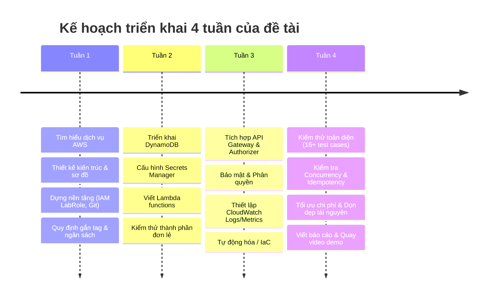

# ĐỀ BÀI ĐỒ ÁN: CỔNG THANH TOÁN GIẢ LẬP

> **Học phần:** Cloud Computing (Điện toán đám mây) – Đợt 1, Năm học 2026–2027  
> **Giảng viên hướng dẫn (GVHD):** ThS. Huỳnh Xuân Phụng  
> **Tên đề tài:** Cổng thanh toán giả lập với API Gateway, Lambda authorizer và DynamoDB transaction  
> **Nhóm thực hiện:** Serverless (02 thành viên: Vũ Minh Đức & Nguyễn Nguyên)  
> **Trạng thái:** Đang đăng ký / Đang thực hiện  

---

## 1. Mục tiêu đề tài

Xây dựng hệ thống API thanh toán giả lập không máy chủ (Serverless Payment Gateway) trên nền tảng AWS, bảo đảm:
- **Tính nhất quán & toàn vẹn dữ liệu tài chính:** Sử dụng Amazon DynamoDB `TransactWriteItems` để đảm bảo trừ tiền ví nguồn, cộng tiền ví đích và ghi nhận giao dịch thành công trong một giao dịch nguyên tử duy nhất (ACID).
- **Cơ chế chống lặp (Idempotency):** Áp dụng header `Idempotency-Key` kết hợp băm dữ liệu yêu cầu để ngăn chặn việc trừ tiền hai lần khi client gửi lại request hoặc gặp sự cố gián đoạn mạng.
- **Xác thực bảo mật:** Kiểm soát truy cập các endpoint chuyển tiền bằng token JWT thông qua Lambda Authorizer, bảo vệ khóa bí mật trong AWS Secrets Manager.

---

## 2. Sản phẩm dự kiến bàn giao

1. **API chuyển tiền giữa ví:** Endpoint tiếp nhận và xử lý giao dịch chuyển tiền an toàn giữa các tài khoản ví.
2. **Lambda Authorizer:** Kiểm tra tính hợp lệ của JWT (chữ ký, hạn dùng, quyền hạn) trước khi chuyển tiếp yêu cầu đến nghiệp vụ chính; khóa bí mật lưu trong AWS Secrets Manager.
3. **Cơ sở dữ liệu DynamoDB:**
   - Bảng quản lý ví (`Wallets`): Lưu trữ thông tin tài khoản, chủ sở hữu, trạng thái và số dư khả dụng.
   - Bảng lịch sử giao dịch (`Transactions`): Lưu vết giao dịch, hỗ trợ kiểm tra và đối chiếu chống lặp (`Idempotency-Key`).
4. **Bộ kịch bản kiểm thử (Test Scenarios):** Đặc biệt chú trọng kịch bản gửi trùng request (idempotent replay), tranh chấp số dư đồng thời (concurrency), và các trường hợp lỗi nghiệp vụ/xác thực.

---

## 3. Yêu cầu kỹ thuật riêng của đề tài

- **Dịch vụ AWS bắt buộc sử dụng:**
  - **Amazon API Gateway:** Tiếp nhận request HTTPS, định tuyến và tích hợp Authorizer.
  - **AWS Lambda:** Xử lý logic cấp token, xác thực và thực thi nghiệp vụ chuyển tiền.
  - **Amazon DynamoDB:** Lưu trữ NoSQL với cơ chế giao dịch nguyên tử `TransactWriteItems`.
  - **AWS Secrets Manager:** Quản lý và bảo vệ khóa bí mật ký token JWT.
  - **Amazon CloudWatch:** Ghi log, giám sát hoạt động và cảnh báo hệ thống.
- **Xác thực JWT:**
  - **Không dùng Amazon Cognito.**
  - **Tự sinh và tự kiểm tra JWT** bằng thư viện Python **`PyJWT`** trong Lambda function.

---

## 4. Kế hoạch triển khai 4 tuần

> **Quy định thời lượng:** Mỗi sinh viên làm việc **≥ 08 giờ/tuần** (tổng cộng ≥ 64 giờ cho cả nhóm trong 4 tuần).

| Tuần | Nội dung công việc trọng tâm | Đầu ra dự kiến |
|:---:|---|---|
| **Tuần 1** | - Tìm hiểu các dịch vụ AWS liên quan. - Phân tích nghiệp vụ, thiết kế kiến trúc hệ thống và vẽ sơ đồ. - Khảo sát nền tảng Learner Lab, xác minh quyền IAM `LabRole`, cấu hình AWS CLI. - Khởi tạo repository Git, chuẩn hóa cấu trúc thư mục và quy tắc gắn tag tài nguyên. | Sơ đồ kiến trúc Mermaid/Draw.io, tài liệu phân tích nghiệp vụ, API contract, schema DynamoDB, báo cáo môi trường và worklog tuần 1. |
| **Tuần 2** | - Triển khai các chức năng lõi trên AWS. - Tạo bảng DynamoDB (`Wallets`, `Transactions`). - Khởi tạo secret mã hóa trong AWS Secrets Manager. - Viết mã nguồn Lambda Functions (Token Lambda, Transfer Lambda) và kiểm thử từng thành phần độc lập. | Bảng DynamoDB hoạt động, secret được tạo, mã nguồn Lambda functions chạy thành công trên AWS. |
| **Tuần 3** | - Tích hợp toàn diện các thành phần hệ thống. - Cấu hình API Gateway HTTP API và tích hợp Lambda Authorizer (REQUEST mode). - Tăng cường bảo mật và kiểm soát truy cập. - Thiết lập giám sát với CloudWatch Logs và CloudWatch Metrics / Alarms. - Xây dựng kịch bản tự động hóa / IaC (nếu có). | API Gateway tích hợp hoàn chỉnh với Lambda & Secrets Manager; luồng xác thực hoạt động thông suốt; CloudWatch ghi nhận đầy đủ log. |
| **Tuần 4** | - Kiểm thử tổng thể toàn bộ hệ thống (kiểm thử chịu tải, tranh chấp số dư, gửi trùng request). - Tối ưu hóa chi phí, đo đạc ngân sách thực tế trên Learner Lab. - Dọn dẹp các tài nguyên không cần thiết. - Hoàn thiện báo cáo tổng kết đồ án và quay video demo (≤ 10 phút). | Báo cáo đồ án hoàn chỉnh, video demo ≤ 10 phút, bảng đối soát chi phí, bằng chứng dọn dẹp tài nguyên. |

---

## 5. Yêu cầu chung và Quy định môn học

### 5.1. Quy mô & Hồ sơ làm việc
- **Quy mô nhóm:** Tối đa 02 sinh viên.
- **Thời gian thực hiện:** Hoàn thành trong đúng 4 tuần.
- **Nhật ký công việc (Worklog):** Bắt buộc nộp nhật ký hằng tuần, ghi rõ chi tiết từng nhiệm vụ phân công, mốc thời gian bắt đầu – kết thúc, và số giờ làm việc thực tế của từng sinh viên (đạt tối thiểu 8 giờ/SV/tuần).

### 5.2. Quy định về việc sử dụng AI / LLM
- Sinh viên **được phép sử dụng LLM/AI** (ChatGPT, Claude, Amazon Q Developer, Gemini...) để tham khảo tài liệu, sinh mã mẫu và hỗ trợ gỡ lỗi.
- **Bắt buộc triển khai thật:** Mọi tài nguyên, hàm và cơ sở dữ liệu phải được triển khai, kiểm thử và chạy thực tế trên môi trường AWS Academy Learner Lab.
- **Tính minh bạch:** Ghi rõ trong tài liệu/worklog phần nào có AI hỗ trợ biên soạn.
- **Trách nhiệm giải trình:** Sinh viên phải hiểu sâu và giải thích được toàn bộ cấu hình, kiến trúc và mã nguồn khi giảng viên vấn đáp.

### 5.3. Giới hạn tài nguyên & Môi trường AWS Learner Lab
- **Region được phép:** Chỉ sử dụng `us-east-1` (US East - N. Virginia) hoặc `us-west-2` (US West - Oregon). Dự án này thống nhất sử dụng **`us-east-1`**.
- **Quyền IAM:** Chỉ sử dụng IAM Role có sẵn là `LabRole` / `LabInstanceProfile`. Tuyệt đối không tạo IAM User, IAM Group hoặc IAM Role mới.
- **Giới hạn EC2/EBS (nếu có dùng):**
  - Chỉ dùng instance type từ `nano` đến `large`.
  - Tối đa ≤ 9 instance và ≤ 32 vCPU chạy đồng thời trên mỗi Region.
  - Dung lượng EBS ≤ 100 GB (loại ổ đĩa gp2/gp3).
  *(Lưu ý: Dự án ưu tiên kiến trúc thuần Serverless, không sử dụng EC2 để tiết kiệm chi phí).*
- **Gắn thẻ tài nguyên (Resource Tagging):** Bắt buộc gắn thẻ cho mọi tài nguyên có thể gắn tag:
  - `Project`: `serverless-payment`
  - `Owner`: `Serverless-Team` (hoặc mã sinh viên tương ứng).
- **Kiểm soát chi phí:** Dừng/xóa tài nguyên sau mỗi buổi làm việc; theo dõi ngân sách hiển thị ($50) và nộp báo cáo chi phí thực tế cuối kỳ.

### 5.4. Yêu cầu về Minh chứng (Evidence)
Sinh viên cần chuẩn bị đầy đủ các sản phẩm minh chứng:
1. **Ảnh chụp màn hình Console / Terminal CLI:** Phải hiển thị rõ ràng Account ID, Region (`us-east-1`), và dấu mốc thời gian (timestamp).
2. **Mã nguồn & Template trên Git:** Commit thường xuyên với message rõ ràng, thể hiện lịch sử đóng góp của từng thành viên.
3. **Báo cáo đồ án:** File tài liệu đầy đủ kèm theo sơ đồ kiến trúc hệ thống trực quan.
4. **Video Demo:** Độ dài **≤ 10 phút**, trình bày rõ ràng luồng hoạt động của hệ thống, kịch bản thành công, kịch bản lỗi và kiểm tra chống lặp Idempotency.

