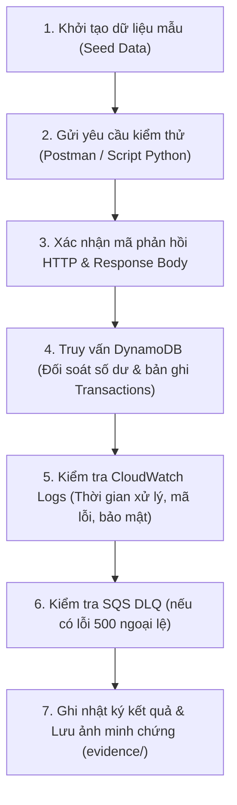

# KẾ HOẠCH & BỘ KỊCH BẢN KIỂM THỬ (TEST PLAN & TEST SCENARIOS)

> **Học phần:** Cloud Computing – Đợt 1, Năm học 2026–2027  
> **Dự án:** Cổng thanh toán giả lập không máy chủ (`serverless-payment`)  
> **Người phụ trách:** Vũ Minh Đức  
> **Phối hợp thực hiện:** Nguyễn Nguyên  
> **Môi trường thực thi:** AWS Academy Learner Lab (`us-east-1`)  
> **Phiên bản:** 1.0 (Thiết kế hoàn chỉnh – Sẵn sàng thực thi từ Tuần 2)  

---

## 1. Mục tiêu và Phạm vi kiểm thử

Tài liệu này xác định kế hoạch và các kịch bản kiểm thử toàn diện cho hệ thống cổng thanh toán giả lập không máy chủ, nhằm bảo đảm:
1. **Tính nguyên tử tài chính (ACID):** Số tiền chuyển giữa hai ví được thực hiện đồng thời, không xảy ra tình trạng trừ tiền một phía hay số dư âm khi gặp lỗi hoặc hủy giao dịch.
2. **Cơ chế chống lặp (Idempotency):** Xử lý an toàn khi client gửi lại request (do retry mạng hoặc thao tác bấm nhiều lần), bảo đảm không trừ tiền hai lần và phản hồi đúng kết quả giao dịch ban đầu.
3. **Bảo mật và kiểm soát truy cập:** Xác thực token JWT qua Lambda Authorizer, kiểm tra chặt chẽ quyền sở hữu ví của người gửi (`sub == ownerId`).
4. **Xử lý tranh chấp đồng thời (Concurrency):** Đảm bảo tính nhất quán dữ liệu khi có nhiều yêu cầu chuyển tiền từ cùng một ví xảy ra trong cùng một thời điểm.

---

## 2. Dữ liệu khởi tạo mẫu (Test Fixtures & Seed Data)

Trước khi thực hiện mỗi chu kỳ kiểm thử, dữ liệu khởi tạo trên bảng DynamoDB `Wallets` được thiết lập như sau:

| Mã ví (`walletId`) | Chủ sở hữu (`ownerId`) | Số dư (`balance`) | Loại tiền (`currency`) | Trạng thái (`status`) | Mục đích thử nghiệm |
|---|---|---:|:---:|:---:|---|
| `W001` | `user-a` | 100.000 | `VND` | `ACTIVE` | Ví nguồn chính của User A |
| `W002` | `user-b` | 50.000 | `VND` | `ACTIVE` | Ví đích nhận tiền của User B |
| `W003` | `user-b` | 20.000 | `VND` | `SUSPENDED` | Ví đích bị khóa (kiểm tra điều kiện) |
| `W004` | `user-a` | 10.000 | `USD` | `ACTIVE` | Ví ngoại tệ (kiểm tra sai loại tiền) |

---

## 3. Ma trận kịch bản kiểm thử chi tiết (Test Scenarios Matrix)

### Nhóm 1: Kiểm thử chức năng cốt lõi (Happy Path)

| Mã | Mô tả kịch bản | Dữ liệu đầu vào | Kết quả kỳ vọng | Kiểm tra cơ sở dữ liệu DynamoDB |
|:---:|---|---|:---:|---|
| **TC-01** | Chuyển tiền thành công giữa 2 ví hợp lệ | JWT `user-a`, `W001` $\rightarrow$ `W002`, 30.000 VND, `Idempotency-Key: K1` | `201 Created` `status: SUCCESS` `replayed: false` | `W001.balance` = 70.000 `W002.balance` = 80.000 Bảng `Transactions` có 1 bản ghi `K1` |
| **TC-02** | Gửi lại cùng request và key đã thành công (Idempotent Replay) | Giữ nguyên toàn bộ payload, header và `Idempotency-Key: K1` như TC-01 | `200 OK` `status: SUCCESS` `replayed: true` | Số dư `W001` vẫn là 70.000 Số dư `W002` vẫn là 80.000 Không sinh bản ghi mới, không trừ thêm tiền |

### Nhóm 2: Kiểm thử cơ chế Chống lặp (Idempotency Control)

| Mã | Mô tả kịch bản | Dữ liệu đầu vào | Kết quả kỳ vọng | Kiểm tra cơ sở dữ liệu DynamoDB |
|:---:|---|---|:---:|---|
| **TC-03** | Tái sử dụng key cũ nhưng thay đổi nội dung (Payload Conflict) | JWT `user-a`, cùng `Idempotency-Key: K1`, đổi `amount: 40000` | `409 Conflict` `code: IDEMPOTENCY_KEY_CONFLICT` | Dữ liệu ví và giao dịch không thay đổi |
| **TC-12** | Gửi song song 10 request cùng key (Burst Replay) | 10 luồng đồng thời gửi cùng payload và `Idempotency-Key: K2` | Đúng 1 request nhận `201 Created`, 9 request còn lại nhận `200 OK` (replayed) | Chỉ thực hiện trừ tiền 1 lần duy nhất; bảng `Transactions` có đúng 1 record `K2` |
| **TC-13** | Gửi lại key cũ sau khoảng thời gian dài (> 10 phút) | Gửi lại `Idempotency-Key: K1` sau 15 phút | `200 OK` `replayed: true` | Không bị trừ tiền thêm; chứng minh không phụ thuộc giới hạn 10 phút của DynamoDB ClientRequestToken |
| **TC-17** | Thử lại cùng key của request từng thất bại trước đó | Gửi request lỗi (ví dụ thiếu tiền) với `K3`, sau đó nạp tiền ví và gửi lại đúng `K3` | Lần 1: `409 INSUFFICIENT_FUNDS` Lần 2: `201 Created` | Request thất bại không chiếm key; cho phép client hoàn tất giao dịch sau khi thỏa điều kiện |

### Nhóm 3: Kiểm thử Xác thực & Phân quyền (Authentication & Authorization)

| Mã | Mô tả kịch bản | Dữ liệu đầu vào | Kết quả kỳ vọng | Ghi chú kỹ thuật |
|:---:|---|---|:---:|---|
| **TC-04** | Yêu cầu không có header `Authorization` | Không gửi header `Authorization` | `401 Unauthorized` | API Gateway chặn trực tiếp tại tầng ingress |
| **TC-05** | Token JWT hết hạn hoặc chữ ký HMAC bị sửa đổi | Gửi JWT hết hạn (`exp` quá khứ) hoặc chữ ký không khớp | `403 Forbidden` | Lambda Authorizer trả về `isAuthorized: false` |
| **TC-06** | Người dùng cố chuyển tiền từ ví của người khác | JWT `user-b`, yêu cầu chuyển tiền từ `W001` (chủ sở hữu là `user-a`) | `403 Forbidden` | Transfer Lambda kiểm tra `sub != ownerId` và từ chối |
| **TC-14** | Yêu cầu thiếu header `Idempotency-Key` | Header hợp lệ nhưng không có `Idempotency-Key` | `400 Bad Request` `code: MISSING_IDEMPOTENCY_KEY` | Dữ liệu ví không thay đổi |
| **TC-15** | Token JWT sai trường `iss` (Issuer) hoặc `aud` (Audience) | JWT ký hợp lệ nhưng `iss: untrusted-issuer` | `403 Forbidden` | Lambda Authorizer kiểm tra claims và từ chối |

### Nhóm 4: Kiểm thử Quy tắc nghiệp vụ (Business Rules Validation)

| Mã | Mô tả kịch bản | Dữ liệu đầu vào | Kết quả kỳ vọng | Ghi chú kỹ thuật |
|:---:|---|---|:---:|---|
| **TC-07** | Số dư ví nguồn không đủ thực hiện giao dịch | `W001` có 100.000 VND, yêu cầu chuyển 200.000 VND | `409 Conflict` `code: INSUFFICIENT_FUNDS` | Điều kiện `balance >= amount` bị vi phạm |
| **TC-08** | Ví nguồn và ví đích trùng nhau | `fromWalletId: W001`, `toWalletId: W001` | `400 Bad Request` `code: INVALID_WALLET` | Chặn từ tầng kiểm tra dữ liệu đầu vào |
| **TC-09** | Chuyển tiền tới ví đích không tồn tại | `toWalletId: W999` (không có trong CSDL) | `404 Not Found` `code: WALLET_NOT_FOUND` | Ví nguồn không bị trừ tiền |
| **TC-10** | Số tiền giao dịch không hợp lệ | `amount` nhận giá trị: `0`, `-50000`, `15.5`, `"30000"`, `true` | `400 Bad Request` `code: INVALID_AMOUNT` | Bắt buộc số nguyên dương VND |
| **TC-19** | Chuyển tiền tới ví đích đang bị khóa (`SUSPENDED`) | `toWalletId: W003` (`status: SUSPENDED`) | `409 Conflict` `code: WALLET_INACTIVE` | Điều kiện `status == ACTIVE` bị vi phạm |

### Nhóm 5: Kiểm thử Tính nguyên tử & Tranh chấp đồng thời (Atomicity & Concurrency)

| Mã | Mô tả kịch bản | Dữ liệu đầu vào | Kết quả kỳ vọng | Kiểm tra bảo đảm tính nhất quán |
|:---:|---|---|:---:|---|
| **TC-11** | Hai yêu cầu khác key rút tiền đồng thời vượt quá số dư | `W001` có 100.000 VND. Gửi đồng thời Request 1 (80.000) và Request 2 (80.000) với 2 key khác nhau | Chính xác 1 request thành công (`201`), 1 request thất bại (`409 INSUFFICIENT_FUNDS`) | Số dư ví còn 20.000 VND; tuyệt đối không xảy ra số dư âm (-60.000 VND) |
| **TC-16** | Mô phỏng lỗi một nhánh trong `TransactWriteItems` | Ví nguồn đủ tiền nhưng ví đích vi phạm điều kiện | Toàn bộ transaction bị rollback, trả về mã lỗi thích hợp | Ví nguồn không bị trừ tiền; không xảy ra lỗi cập nhật một phần |
| **TC-18** | Đọc nhất quán sau khi hoàn tất giao dịch | Đọc trạng thái ví ngay sau khi nhận phản hồi `201` | Dữ liệu số dư phản ánh chính xác giá trị mới | Đảm bảo tính nhất quán tức thì (Strong Consistency) |

### Nhóm 6: Kiểm thử Kiểm soát lưu lượng & Khả năng chịu lỗi (Rate Limiting & DLQ Resilience)

| Mã | Mô tả kịch bản | Dữ liệu đầu vào | Kết quả kỳ vọng | Cơ chế kiểm tra hạ tầng AWS |
|:---:|---|---|:---:|---|
| **TC-20** | Gửi request dồn dập vượt ngưỡng Rate Limit (Throttling) | Gửi burst 30 requests/giây liên tục vào route `/token` hoặc `/transfers` | Các request vượt ngưỡng nhận `429 Too Many Requests` kèm header `Retry-After` | Chặn trực tiếp tại API Gateway Ingress; không kích hoạt Lambda và không tính chi phí backend |
| **TC-21** | Mô phỏng sự cố hệ thống nghiêm trọng kích hoạt DLQ | Giả lập lỗi ngoại lệ chưa xử lý (unhandled error/timeout) trong Transfer Lambda | Trả về `500 Internal Server Error`, payload gốc tự động chuyển vào SQS DLQ | Truy vấn hàng đợi `serverless-payment-dlq` xác nhận message được lưu vết an toàn |

---

## 4. Quy trình & Kế hoạch thực thi kiểm thử

### Lộ trình thực hiện qua các tuần:
- **Tuần 2 (Kiểm thử chức năng lõi & Đơn vị):** Thực hiện các ca kiểm thử cơ bản sau khi triển khai Lambda và DynamoDB (`TC-01`, `TC-04` đến `TC-10`, `TC-14`, `TC-15`).
- **Tuần 3 (Kiểm thử tích hợp, Chống lặp, Rate Limit & DLQ):** Thực hiện kiểm thử tích hợp toàn diện luồng API Gateway Throttling, Authorizer, Idempotency, Concurrency và SQS DLQ (`TC-02`, `TC-03`, `TC-11`, `TC-12`, `TC-13`, `TC-16`, `TC-17`, `TC-19`, `TC-20`, `TC-21`).
- **Tuần 4 (Nghiệm thu tổng thể & Demo):** Tái thực thi toàn bộ 21 kịch bản kiểm thử, lưu trữ ảnh chụp minh chứng và quay video demo hệ thống (thời lượng $\le$ 10 phút).

---

## 5. Biểu mẫu ghi nhận kết quả kiểm thử (Test Execution Log)

Bảng đối soát được sử dụng để ghi nhận kết quả thực tế trong các đợt chạy trên AWS Learner Lab:

| Mã TC | Tên kịch bản | HTTP kỳ vọng | HTTP thực tế | Trạng thái số dư ví / Hạ tầng | Kết quả | Tệp minh chứng |
|:---:|---|:---:|:---:|---|:---:|---|
| **TC-01** | Chuyển tiền thành công | `201` | `201` | `W001 -30k`, `W002 +30k` | **Đạt** | [`A2-13`](../evidence/week02/duc/A2-13-transfer-test-success.png), [`A2-18`](../evidence/week02/duc/A2-18-api-transfer-success.png) |
| **TC-02** | Gửi lại cùng key (Replay) | `200` | `200` | Không đổi số dư, `replayed: true` | **Đạt** | [`A2-14`](../evidence/week02/duc/A2-14-transfer-test-idempotent-replay.png) |
| **TC-03** | Trùng key khác nội dung | `409` | `409` | Không đổi số dư | **Đạt** | [`A2-15`](../evidence/week02/duc/A2-15-transfer-test-idempotency-conflict.png) |
| **TC-04** | Thiếu Authorization | `401` | _(Ghi nhận Tuần 3)_ | Không tác động | _Đang chờ_ | `evidence/week03/...` |
| **TC-05** | Token JWT hết hạn | `403` | _(Ghi nhận Tuần 3)_ | Không tác động | _Đang chờ_ | `evidence/week03/...` |
| **TC-06** | Chuyển tiền ví người khác | `403` | `403` | Không tác động | **Đạt** | [`A2-16`](../evidence/week02/duc/A2-16-transfer-test-wallet-forbidden.png) |
| **TC-07** | Không đủ số dư | `409` | `409` | Không đổi số dư | **Đạt** | [`A2-12`](../evidence/week02/duc/A2-12-transfer-test-insufficient-funds.png) |
| **TC-08** | Chuyển cho chính mình | `400` | _(Ghi nhận Tuần 2)_ | Không tác động | _Đang chờ_ | `evidence/week02/...` |
| **TC-09** | Ví đích không tồn tại | `404` | _(Ghi nhận Tuần 2)_ | Không tác động | _Đang chờ_ | `evidence/week02/...` |
| **TC-10** | Số tiền không hợp lệ | `400` | _(Ghi nhận Tuần 2)_ | Không tác động | _Đang chờ_ | `evidence/week02/...` |
| **TC-11** | Hai giao dịch tranh chấp | `201 & 409` | _(Ghi nhận Tuần 3)_ | Chỉ trừ 1 lần, không âm | _Đang chờ_ | `evidence/week03/...` |
| **TC-12** | 10 request song song cùng key | `1x 201, 9x 200` | _(Ghi nhận Tuần 3)_ | Chỉ trừ 1 lần duy nhất | _Đang chờ_ | `evidence/week03/...` |
| **TC-20** | Vượt ngưỡng Rate Limit | `429` | _(Ghi nhận Tuần 3)_ | Chặn tại Gateway, Retry-After header | _Đang chờ_ | `evidence/week03/...` |
| **TC-21** | Ngoại lệ hệ thống chuyển DLQ | `500` | _(Ghi nhận Tuần 3)_ | Message chuyển vào SQS DLQ an toàn | _Đang chờ_ | `evidence/week03/...` |
